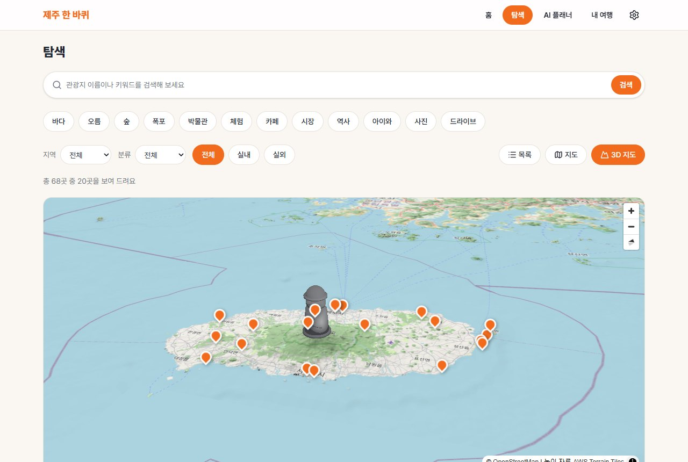
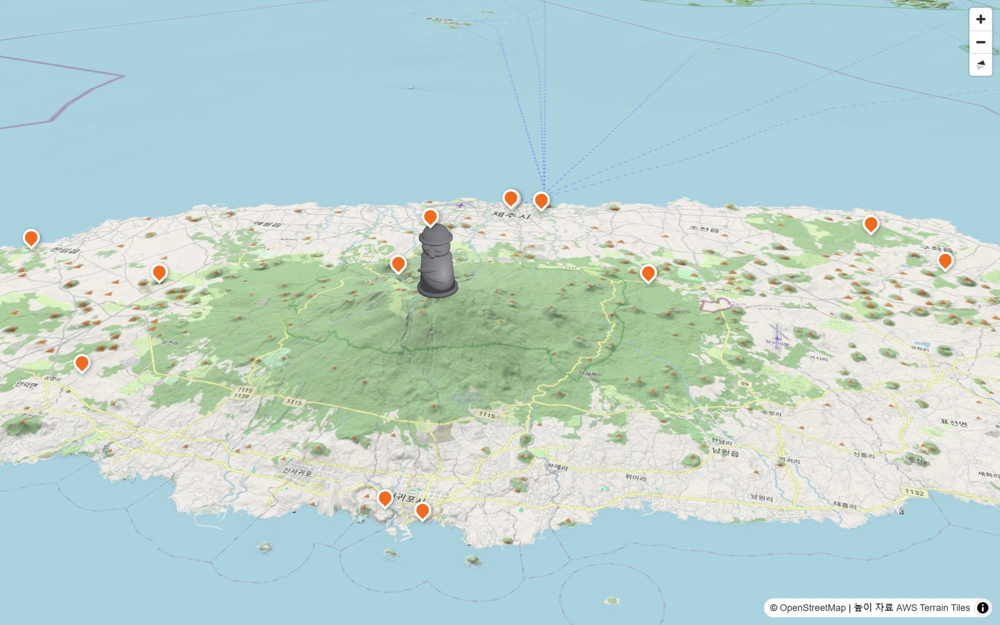
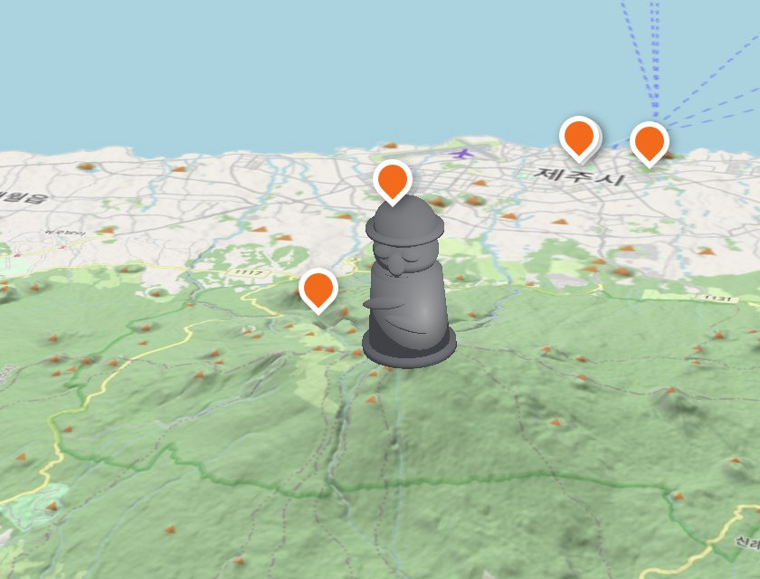
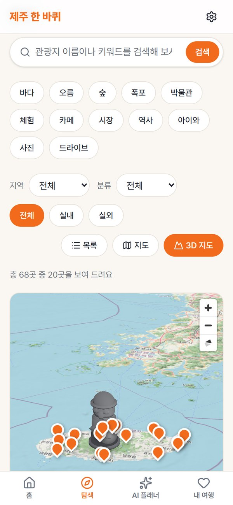
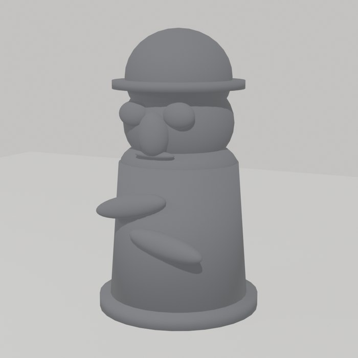
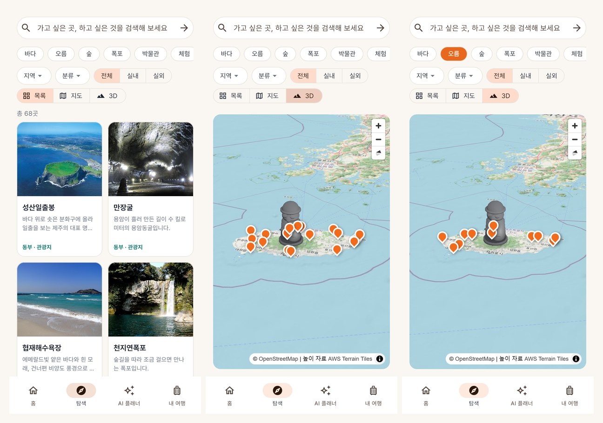

# 3D 지도 — 한라산을 세우고 돌하르방을 올리기

탐색 화면의 보는 방식은 목록 · 지도 · **3D 지도** 세 가지입니다. 3D 지도는 땅의 높낮이를 세워 비스듬히 내려다보고, 블렌더로 만든 돌하르방 모델을 한라산에 세웁니다. 웹에서 한 번 만들고, 앱은 그 화면을 그대로 띄웁니다.

아래 화면은 모두 로컬에서 실제로 실행해 캡처한 것입니다(2026-11-26, 서버 + 로컬 DB 68건).

## 화면

### 웹 — 탐색 → 3D 지도



주소는 `/explore?view=3d` 입니다. 검색어 · 테마 · 지역 · 분류 · 실내/실외 필터가 그대로 적용되고, 핀을 누르면 이름과 "자세히" 링크가 나옵니다.

### 웹 — 한라산과 오름의 높낮이



한라산과 주변 오름이 솟아 보이고 그림자가 굴곡을 드러냅니다. 높이는 실제의 1.5배로 과장했습니다.

| 지도 위의 모델 | 휴대폰 폭(390px) |
|---|---|
|  |  |

모델은 지도를 확대하거나 축소해도 화면에서 비슷한 크기로 보이게 맞췄습니다.

### 블렌더 — 돌하르방 모델



구와 원기둥 열두 개(받침 · 몸통 · 어깨 · 머리 · 모자 챙 · 모자 · 두 눈 · 코 · 입 · 두 손)를 합치고 현무암 색 재질을 입혔습니다. 원본은 `tools/dolhareubang.blend`, 웹에서 쓰는 파일은 `web/public/models/dolhareubang.glb`(약 230KB)입니다.

### 앱 — 탐색 → 3D



왼쪽부터 탐색(목록), 3D, 테마 "오름"을 고른 3D 입니다. 이 캡처는 앱을 크롬으로 실행해 휴대폰 크기(412 × 870)로 찍었습니다. 안드로이드 에뮬레이터(Pixel 4)에서도 지형 · 모델 · 핀이 뜨는 것을 따로 확인했습니다(모델 모양을 다듬기 전).

## 어떻게 만들었나

```
블렌더  ──(glb 내보내기)──▶  web/public/models/dolhareubang.glb
                                        │
[web] 탐색 view=3d ──▶ SpotMap3D ──┬─ MapLibre GL JS : 바탕 지도 + 땅 높이 + 그림자
                                   └─ Three.js       : 모델을 지도와 같은 캔버스에 그림
[web] /embed/map3d   ──▶ 지도만 화면 가득 (앱에 끼워 넣는 주소)
[app] 탐색 "3D"      ──▶ 웹뷰(webview_flutter)로 /embed/map3d 를 띄움
```

| 무엇 | 어디 | 메모 |
|---|---|---|
| 지도 설정과 계산(순수 함수) | `web/src/lib/map3d.ts` | 지도 모양, 핀을 담는 범위, 모델 크기 계산. 테스트 `map3d.test.ts` |
| 3D 지도 화면 | `web/src/components/SpotMap3D.tsx` | MapLibre 지도 + Three.js 사용자 레이어 |
| 브라우저에서만 불러오기 | `web/src/components/SpotMap3DView.tsx` | 서버에서 실행하면 오류가 나고 용량도 커서 필요할 때만 받음 |
| 앱에 끼워 넣는 주소 | `web/src/app/embed/map3d/page.tsx` | 탐색과 같은 필터 쿼리를 받음 |
| 앱의 웹뷰 | `app/lib/widgets/spot_map_3d.dart`, `app/lib/map3d.dart` | 고른 필터를 주소로 넘김. 웹 주소는 `env.json` 의 `WEB_URL` |
| 모델 만들기 | `tools/make_model_blender.py`, `tools/dolhareubang.blend` | 블렌더 5.3 |

- **바탕 지도**: OpenStreetMap 타일. **높이 자료**: AWS Terrain Tiles. 둘 다 키 없이 씁니다. 출처는 지도 오른쪽 아래 ⓘ 단추에 표기합니다.
- **모델을 세우는 자리**: 한라산의 경도 · 위도에 그 자리의 땅 높이(`queryTerrainElevation`)를 더합니다. 모델은 Y 축이 위, 지도는 Z 축이 위라서 X 축으로 90도 세웁니다.
- **`maplibre-gl` 은 5 버전**을 씁니다. 6 버전은 Next.js(Turbopack) 개발 서버에서 워커 파일을 불러오지 못해 땅이 평평하게 나왔습니다.

## 모델 다시 만들기

블렌더가 깔린 PC 에서, 저장소 맨 위 폴더에서 실행합니다.

```powershell
& "C:\Program Files\Blender Foundation\Blender 5.3\blender.exe" --background --python tools/make_model_blender.py
```

`tools/dolhareubang.blend` 와 `web/public/models/dolhareubang.glb` 가 다시 만들어집니다. 내 주제의 모델로 바꾸려면 블렌더에서 만든 모델을 같은 이름의 glb 로 내보내 덮어씁니다. 약속은 두 가지입니다 — 바닥이 원점, 키가 1미터.

## 앱에서 볼 때

앱의 3D 는 웹 화면을 띄우는 것이라 **서버와 함께 웹도 켜져 있어야** 합니다. 실행 방법과 막힐 때의 확인 순서는 [app-run.md](app-run.md)의 "3D 지도"에 있습니다. 에뮬레이터의 웹뷰는 내 PC 를 `10.0.2.2` 로 부르기 때문에 세 가지를 맞춰 두었습니다.

1. `web/next.config.ts` 의 `allowedDevOrigins` 에 `10.0.2.2`
2. 화면이 `10.0.2.2` 에서 열렸으면 서버 주소의 `localhost` 를 `10.0.2.2` 로 바꿔 부르는 규칙(`web/src/lib/apiUrl.ts`)
3. 서버 CORS 에 `10.0.2.2` 허용(`api/main.py`)

## 확인한 것과 아직인 것

| 확인한 것 | 아직 확인하지 못한 것 |
|---|---|
| 웹: 넓은 화면 · 휴대폰 폭에서 지형 · 모델 · 핀 · "자세히" 링크 | 실제 안드로이드 폰 |
| 웹: 배포 주소(Vercel)에서 3D 지도 | 배포한 앱 웹 빌드에서의 3D |
| 앱: 크롬 실행(테마 필터 포함), 에뮬레이터(Pixel 4) | 앱의 3D 화면에서 핀 → 상세 화면 이동(지금은 이름만 보임) |
| 검사: 서버 테스트 154 · 웹 테스트 97 · 앱 테스트 125 · 디버그 apk 빌드 | 35명이 동시에 쓸 때의 지도 타일 속도 |
