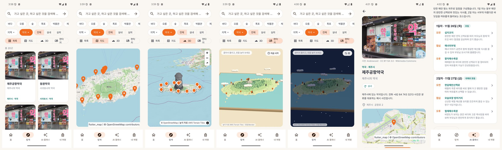

# 작업 체크리스트 — 제주 한 바퀴

마지막 갱신: 2026-11-20

## 일하는 순서 (기능 하나마다)

1. **기능 단위로 나눈다** — 서버 기능과 화면(웹·앱)은 따로 작업한다.
2. **단위 테스트** — 서버 `pytest`, 웹 `npm test`, 앱 `flutter test`
3. **기능 확인** — 로컬에서 실제로 실행해 본다 (서버 `/docs`, 실제 DB, 실제 외부 API)
4. **실측 점검** — `python -m tools.check_live --token local-dev-token` (켜져 있는 서버 + DB)
5. **화면 확인** — 웹은 브라우저(휴대폰 폭 + 넓은 화면), 앱은 에뮬레이터 또는 크롬
6. **커밋 → 푸시** — 확인이 끝난 것만. 커밋 메시지에 무엇을 확인했는지 적는다.
7. 이 문서의 표를 갱신한다.

VS Code 에서는 `Ctrl+Shift+P` → `Tasks: Run Task` 의 "검사: …" 작업으로 2·4번을, "서버 + 웹 함께 실행" 으로 3·5번을 합니다.

표의 기호: ✅ 확인함 · ⏳ 아직 못 함(이유) · — 해당 없음

"로컬 DB"는 `dev/docker-compose.yml` 로 띄운 PostgreSQL 입니다. 진짜 Supabase 프로젝트로 확인한 것은 아래 "실제 배포 (2026-11-22)"에 따로 적었습니다.

## 서버 기능

| 기능 | 단위 테스트 | 기능 확인 (로컬 실행) | 실측 점검 (HTTP → 서버 → DB) |
|---|---|---|---|
| 관광지 목록·검색·필터·쪽 나눔 `GET /spots` | ✅ 5건 | ✅ | ✅ 전체 68건, 테마 '바다' 23건, 실내 19건, 검색, 쪽 겹침 없음 |
| 검색어로 필터 조작 차단 | ✅ | ✅ | ✅ |
| 관광지 상세 `GET /spots/{id}` | ✅ 404 포함 | ✅ | ✅ |
| 선택지 `GET /meta` | ✅ | ✅ | ✅ |
| 날씨 `GET /weather` | ✅ 5건 | ✅ | ✅ 실제 Open-Meteo, 제주시·서귀포시 4일치 |
| 외부 데이터 가공 `transform.py` | ✅ 11건 | ✅ 샘플 68건 변환·적재, 다시 실행해도 68건 | — |
| TourAPI 받아 오기 `tools/sync_spots.py` | — | ⏳ 키가 없어 한 번도 호출하지 못함 | ⏳ |
| 로그인 확인 (토큰 없음·틀림 → 401) | ✅ 3건 | ✅ | ✅ / ⏳ 진짜 구글 토큰으로는 미확인 (로컬은 로그인 흉내) |
| 찜 `/me/favorites` | ✅ 4건 | ✅ | ✅ 추가 → 목록 → 없는 관광지 404 → 삭제 |
| 저장한 일정 `/me/trips` | ✅ 3건 | ✅ | ✅ 저장 → 그대로 조회 → 삭제 → 다시 삭제 404 |
| AI 일정 `POST /agent/plan` — 규칙 방식 | ✅ 5건 | ✅ | — |
| AI 일정 — AI 방식 | ✅ 7건 | ✅ | ✅ 실제 Gemini, DB 장소만 사용, 1일 일정 8.6초 |
| 다른 주소 화면 허용(CORS) | — | ✅ | ✅ 웹(3000)·에뮬레이터에서 호출됨 |

서버 테스트 합계 **93건 통과**, 실측 점검 **26개 통과**(2026-11-20 구조 정리 뒤, 로컬 DB). 표의 건수는 기능을 처음 만들 때의 것입니다.

응답 시간(로컬): DB 조회 5~7ms, 찜·일정 190~280ms(로그인 확인 왕복 포함), 날씨 첫 호출 2.3초(이후 10분 캐시), AI 일정 1일 8.6초 · 2~3일 14~21초.

## 웹 화면 (Next.js)

검사: lint 0건 · 타입 오류 0건 · 테스트 41건 통과 · 빌드 성공

| 화면·기능 | 휴대폰 폭 (375) | 넓은 화면 | 서버·DB 연결 |
|---|---|---|---|
| 홈 (검색·날씨 배너·테마 칩·추천) | ✅ | ✅ | ✅ |
| 탐색 — 목록·필터 | ✅ | ✅ | ✅ |
| 탐색 — 지도 | — | ✅ | ✅ |
| 상세 / 없는 번호 안내 | ✅ | ✅ | ✅ |
| AI 플래너 — 일정 생성 | — | ✅ | ✅ 실제 AI 응답 |
| 내 여행 — 로그인 전 | ✅ | — | — |
| 내 여행 — 로그인 후 (이메일·찜한 곳) | — | ✅ | ✅ 로컬 DB + 로그인 흉내 |
| 찜하기 버튼 (상세) | — | ✅ "찜하기" → "찜한 곳" | ✅ DB 에 들어간 것 확인 |
| 일정 저장 (제목 입력 → 저장) | — | ✅ | ✅ |
| 저장한 일정 — 펼쳐 보기·삭제 | — | ✅ | ✅ 삭제 후 DB 0건 |
| 구글 로그인 버튼 → 구글 → 돌아오기 | ⏳ | ⏳ | ⏳ Supabase·Google OAuth 설정 필요 |
| 로그아웃 | ⏳ | ⏳ | ⏳ 로그인 흉내로는 확인 불가 |

로그인 후 화면은 브라우저 저장소에 가짜 로그인 정보를 넣어 확인했습니다(코드에는 그런 경로가 없습니다). 진짜 구글 로그인은 Supabase 설정 뒤 다시 확인해야 합니다.

## 앱 화면 (Flutter)

검사: analyze 문제 0건 · 테스트 64건 통과 · 디버그 APK 빌드 성공

| 화면·기능 | 크롬(웹 빌드) | 안드로이드 에뮬레이터 (Pixel 4) | 서버 연결 |
|---|---|---|---|
| 홈 | ✅ | ✅ | ✅ `10.0.2.2:8000` |
| 탐색 — 목록·필터 | ✅ | ✅ | ✅ |
| 탐색 — 지도 | ⏳ | ✅ 핀·지도 타일 표시 | ✅ |
| 상세 (지도 포함) | ✅ | ✅ | ✅ |
| AI 플래너 — 일정 생성 | ⏳ 입력 화면만 | ✅ 1일 일정 결과 표시 | ✅ 실제 AI 응답 |
| 내 여행 — 로그인 전 | ✅ | ✅ | — |
| 구글 로그인(앱으로 돌아오기)·찜·일정 저장 | ⏳ | ✅ 2026-11-22 아래 "앱 로그인 실측" | ✅ 배포 서버 · 운영 Supabase |
| 한글 직접 입력 | — | ⏳ adb 로는 영문만 입력해 확인 | — |

## 사진과 예시 데이터 (2026-11-20)

| 항목 | 단위 테스트 | 기능·실측 확인 | 화면 확인 |
|---|---|---|---|
| 사진 출처 칸 `image_credit` · `image_source_url` (DB 002, API) | ✅ 서버 3건 추가(합계 50건) | ✅ 로컬 DB 에 002 적용, 실측 21개 통과(AI 제외), `/spots/1` 응답에 출처 포함 | — |
| 공개 라이선스 사진 적용 (위키미디어 공용) | — | ✅ 55 / 68곳. 사진 주소 55개 모두 200 응답 | ✅ 웹 탐색·상세, 에뮬레이터 탐색·상세에 사진 표시 |
| 사진 출처 표시 | ✅ 웹 3건·앱 2건 추가 | — | ✅ 웹: 사진 아래 "사진: 저작자 · 라이선스" 링크(새 탭) / 앱: 사진 아래 글자 |
| 예시 찜·일정 넣기 `tools/seed_demo.py` | ✅ 2건 (커서 페이징 뒤 다시 맞춤 — 두 번 넣어도 중복 없음, 25개도 모두 비움) | ✅ 비우기 → 찜 6개·일정 2개 → 다시 실행해도 중복 없음 → 틀린 토큰 거부. 커서 페이징 뒤에는 넣기만 로컬 서버로 다시 확인, 비우기는 테스트로만 확인 ⏳ | — |

- 사진은 후보를 자동으로 모은 뒤 사람이 그림을 보고 골랐습니다. 장소가 확실하지 않은 후보는 쓰지 않았습니다(13곳은 대체 그림).
- 출처 목록: [photo-credits.md](photo-credits.md)
- ⏳ 사진이 없는 13곳: 본태박물관, 빛의 벙커, 휴애리, 아부오름, 스누피가든, 이중섭미술관, 절물자연휴양림, 한담해안산책로, 테디베어뮤지엄, 제주도립미술관, 흑돼지거리, 아랑조을거리, 9.81파크
- 사진 55장(11MB)을 `api/static/photos/` 에 넣고 우리 서버가 내주도록 바꿨습니다. 응답의 사진 주소에는 요청이 들어온 서버 주소가 붙습니다.
  - ✅ 서버 테스트 6건 추가(합계 56건), 실측 23개 통과(사진이 실제로 받아지는지 포함)
  - ✅ 웹: 사진이 `localhost:8000` 에서 옴 / 에뮬레이터: 앱 저장 공간을 비운 뒤에도 사진 표시(`10.0.2.2:8000`)
  - ✅ 2026-11-22 Vercel 에 올린 서버에서 사진이 받아지고 주소가 https 로 나옴 (`PUBLIC_API_URL` 을 넣은 상태. 넣지 않았을 때는 확인하지 않음)

## 코드 분석 — 리팩토링 · 메모리 · 비동기 (2026-11-20)

탐색 3축 → 반박 검증 2렌즈 → 3표 중 2표 이상만 확정. 전체 기록(보류·기각 이유 포함): [code-analysis-2026-11-20.md](code-analysis-2026-11-20.md)

| 구분 | 건수 | 확인 |
|---|---|---|
| 후보 | 20 | — |
| 고친 것 | 12 | 테스트를 먼저 추가해 실패 확인 후 수정: 서버 +18건(합계 74), 웹 +7건(합계 23), 앱 +11건(합계 37) |
| 보류 | 8(일부 포함) | 아래 "결정이 필요한 것" |
| 기각 | 11(일부 포함) | 기록 문서에 이유 |

| 실측 (로컬) | 전 | 후 |
|---|---|---|
| `/me` (로그인 확인) | 213ms | 2ms |
| 찜 추가 | 253ms | 50ms |
| 일정 저장 | 267ms | 51ms |
| 날씨 첫 호출 | 2.3초 | 1.2초 |

- ✅ 실측 점검 25개 통과(수정 후)
- ✅ 웹: "더 보기"(20 → 40곳), "더 보기 직후 필터 변경"에서 멈추지 않고 새 결과 표시, 날씨 배너
- ✅ 에뮬레이터: 수정된 앱으로 AI 일정 요청, 날짜가 웹과 같은 "1일차 · 11월 20일 (금)" 로 표시
- ⏳ 배포 서버가 실제로 세계 표준시인지, AI 20초 제한이 배포 환경에서 맞는지는 배포 후 확인

### 보류했던 것의 처리

- [x] 규칙 방식 일정에서 말한 장소가 일수보다 많을 때 → 하루 3곳까지 넣고, 못 넣은 곳은 답변에 "넣지 못한 곳"으로 알림
- [x] `transform.py` 의 오분류 → `CORRECTIONS` 예외표로 수정 (한림공원·제주돌문화공원 실외, 새별오름·금오름·산방산 '바다' 제거, 흑돼지거리 '시장' 제거)
- [x] 로그인 뒤에도 짜 둔 일정 되살리기 → 웹: 브라우저 탭 저장소에 30분 보관, 로그인 뒤 `/planner` 로 돌아옴
- [x] 배포 안내서에 "Vercel 함수 지역을 Supabase 지역과 맞춘다" → [deploy.md](deploy.md) 2단계, `api/vercel.json` 의 `icn1`
- [ ] 앱 카드 사진을 작게 디코딩할지(저사양 기기에서 문제가 보이면)
- [ ] AI 가 일수보다 적은 날짜만 돌려준 경우의 처리
- [ ] AI 가 날씨 도구를 부르는 왕복 줄이기

## 구조 정리 · 남은 기능 · 문서 (2026-11-20)

수업에서 "만들고 · 올리고 · 운영하고 · 고치는" 전 과정을 보여 주기 위해 구조를 층으로 나눴습니다. 설명: [architecture.md](architecture.md)

| 묶음 | 한 일 | 검사 | 실제로 켜서 본 것 |
|---|---|---|---|
| 서버 | `routers/`(주소) · `services/`(일) · `repo.py`(DB)로 나눔. 일정 짜기에 전략 패턴(`AiPlanner` · `RulePlanner`). `GET /status` 추가 | pytest 93건 | 실측 점검 26개 통과(실제 Gemini 포함) |
| 웹 | `app/`(화면) · `hooks/`(상태) · `lib/`(순수 함수·서버 호출)로 나눔. 짠 일정 되살리기 | lint 0 · 타입 0 · 테스트 41건 · 빌드 | 일정 생성 → 새로고침해도 남음 → 로그인 상태에서 저장 → 보관분 삭제 |
| 앱 | `screens/`(화면) · `controllers/`(상태) · `api/`(서버 호출)로 나눔. 상세 화면 여는 코드 한 곳으로 | analyze 0 · 테스트 64건 · 디버그 APK | 에뮬레이터에서 홈 · 탐색 · 상세 |
| 문서 | [구조와 설계](architecture.md) · [배포 안내](deploy.md) · [운영과 수정](operations.md) 새로 씀 | — | — |

- ✅ 2026-11-22 [배포 안내](deploy.md) 1 ~ 4 · 6단계를 실제 배포에 맞춰 고침 → 아래 "실제 배포" / ⏳ 5단계(앱)는 아직 해 보지 않음
- ✅ 2026-11-22 구조 정리 뒤 앱의 AI 플래너 · 내 여행 화면을 에뮬레이터에서 다시 확인(아래 "앱 로그인 실측")

### AI 사용량 보기 (2026-11-23)

결정(사용자): 관리자는 전체, 로그인한 사용자는 자기 것. 횟수와 토큰 수를 기록.

| 조각 | 만든 것 | 검사 | 실측 |
|---|---|---|---|
| DB | `004_ai_usage.sql` — `ai_usage` 표(누가 · 방식 · 쓴 키 · 며칠 · 걸린 시간 · AI 왕복 수 · 토큰). 요청 글 · 일정 · 키는 적지 않음. 서버만 읽고 씀 | — | 로컬 Docker DB 에 적용 · 표 구조 확인. **운영 DB**: 사람이 SQL Editor 에서 실행 → ✅ 2026-11-24 배포 웹에 로그인한 채 설정 화면을 열어 `GET /me/ai-usage?days=30` 이 200 임을 확인(표가 없으면 503) |
| 서버 | 일정 짜기마다 한 줄 기록(실패해도 일정은 돌려줌), `GET /me/ai-usage`, `GET /admin/ai-usage`(날짜별 · 사용자별). AI 도구 호출을 직접 돌려 왕복마다 토큰을 더함. 실패한 AI 시도의 토큰도 셈 | pytest 152건(새 15건, 먼저 쓰고 실패 확인) | 로컬 12항목 통과: 로그인 없이 · 로그인한 채로 일정 → 줄이 생기고 토큰이 잡힘 / 내 것만 · 전체 / 사용자별에 로그인 안 한 줄 따로 / 401 · 422. `check_live` 35개 |
| 웹 | 설정의 "내 AI 사용량", 관리자의 "AI 사용량" 탭(`components/UsageView.tsx`, 기간 7 · 30 · 90일) | lint · tsc · 테스트 83건(새 3건) · 빌드 | 폭 390, 로그인 흉내: 설정에 요청 1 · 토큰 3,515 · 날짜별 표 / 관리자 탭에 합계 · 날짜별 · 사용자별. 화면 밖으로 나가는 요소 없음. 로그인 전에는 안내 문구 |
| 앱 | 설정 화면의 "내 AI 사용량"(`widgets/usage_panel.dart`) | analyze 0 · 테스트 109건(새 6건) | ⏳ 에뮬레이터 실측은 하지 않음(로컬 DB 로는 앱에서 로그인할 수 없음) |

- 실측에서 확인한 것: SDK 에 도구 호출을 맡기면 마지막 왕복의 토큰만 알 수 있음(실제 289인데 171로 보임) → 직접 돌리는 방식으로 바꿔 합계를 기록. 일정 품질은 2일 · 3일 요청으로 다시 확인(AI 일정, 일자 수 일치)
- 알아 둘 것: 한 번의 AI 응답이 20초를 넘기면 지금도 간단 추천으로 넘어감(3일 요청 2번 중 1번 발생, 26초). 그때 쓴 토큰도 이제 기록됨
- 알아 둘 것: 한 번에 최근 1000줄까지만 더함(Supabase API 의 한도). 넘으면 응답의 `truncated` 와 화면 안내로 알림. 사용이 많아지면 DB 에서 날짜별로 미리 더하는 보기(view)가 필요
- ⏳ 토큰 수를 금액으로 바꿔 보여 주지는 않음(모델별 단가가 바뀌므로 넣지 않음)
- ✅ 운영 DB 에 004 적용됨(2026-11-24). 배포 주소에서 로그인한 채 1일 일정을 한 번 짬(`POST /agent/plan` 200) → 설정 화면의 내 사용량이 0 → 요청 1 · AI 1 · 토큰 4,633(내 키 1회, 서버 키 0)으로 늘어남. 관리자 화면의 AI 사용량 탭도 `GET /admin/ai-usage` 200, 오늘 요청 1회로 같은 값

### 일정 자동 저장 · 다른 화면에 다녀와도 이어 보기 (2026-11-23)

결정(사용자): 로그인한 사용자는 일정이 만들어지면 자동 저장. 서버가 저장한다(웹 · 앱이 함께 맞고, 화면을 떠나도 저장됨). 로그인하지 않은 사람은 지금까지처럼 "내 여행에 저장".

| 조각 | 만든 것 | 검사 | 실측 |
|---|---|---|---|
| 서버 | `POST /agent/plan` 에 로그인 "선택"(`get_optional_user`). 로그인했으면 `repo.add_trip` 으로 저장하고 `saved_trip {id, title}` 을 돌려줌. 제목 = 요청 글 한 줄 30자. 정지 계정 · 틀린 토큰 · 저장 실패는 일정만 돌려줌 | pytest 137건(새 7건, 먼저 쓰고 실패 확인) | 로컬 8항목 통과: 로그인 없이 · 틀린 토큰 → 저장 안 됨 / 로그인 → 목록 맨 위에 생기고 내용이 응답과 같음 / 실측용 일정 삭제. `check_live` 35개 |
| 웹 | 자동 저장되면 저장 폼 대신 "내 여행에 자동으로 저장했어요" + 내 여행 링크. 진행 중인 요청을 모듈에 붙들어 다른 메뉴에 다녀와도 "짜고 있어요"가 이어짐 | lint · tsc · 테스트 80건 · 빌드 | 로그인 흉내: 일정 짜기 → 바로 탐색으로 갔다가 돌아옴 → 진행 표시와 입력 글 유지 → 끝나면 자동 저장 안내(저장 폼 없음) → DB 에 그 제목의 일정 1건 확인 후 삭제 |
| 앱 | 자동 저장되면 저장 단추 대신 안내, "내 여행" 목록 다시 불러오기 | analyze 0 · 테스트 103건(새 4건) | ⏳ 에뮬레이터 실측은 하지 않음(로컬 DB 로는 앱에서 로그인할 수 없음. 서버 쪽은 웹과 같은 주소) |

- 알아 둘 것: AI 일정은 지금도 "요청 한 번에 답을 기다리는" 방식입니다. 탭을 닫거나 새로 고치면 화면은 결과를 못 받지만, 서버가 끝까지 처리했다면 로그인한 사용자의 일정은 "내 여행"에 남습니다(끝까지 처리되는지는 배포 환경에 달려 있어 보장하지 않음 — ⏳ 미확인)
- ⏳ 시험 삼아 짠 일정도 모두 저장되므로 "내 여행"에 일정이 빨리 쌓임. 제목 바꾸기 · 한꺼번에 지우기는 없음
- ✅ 2026-11-23 배포 웹에서 진짜 로그인으로 자동 저장되는 것은 사람이 직접 확인(확인했다고 전달받음)

### 내 AI 키 — 설정 화면 (2026-11-23)

결정(사용자): 키는 기기에만 보관(웹 localStorage · 앱 기기 보안 저장소), 키를 넣지 않은 사람은 지금처럼 서버 키로.

| 조각 | 만든 것 | 검사 | 실측 |
|---|---|---|---|
| 서버 | `POST /agent/plan` 이 `X-Gemini-Key` 헤더의 키로 먼저 시도(실패하면 서버 키 → 규칙, 응답 `notice` 로 알림), `POST /agent/key-check` | pytest 130건(새 15건, 먼저 쓰고 실패 확인) | 서버 키를 비운 임시 서버에서 10항목 통과: 키 없이 → 간단 추천 / 맞는 키 → AI 일정(10.8초) / 틀린 키 → 간단 추천 + 안내 / 모양 틀림 422 / 키 확인 맞음 · 틀림 · 헤더 없음 / 응답과 서버 로그에 키가 남지 않음 |
| 웹 | `/settings`(오른쪽 위 톱니바퀴), `lib/aiKey.ts` · `hooks/useAiKey.ts` · `components/AiKeySettings.tsx`, 플래너의 안내 표시 | lint · tsc · 테스트 80건(새 9건) · 빌드 | 폭 390: 틀린 모양 → 까닭 표시 · 저장 안 됨 / 가짜 키 저장 → `AIza…WXYZ` 로만 표시(화면에 키 전체 없음) / 키 확인 → "쓸 수 없는 키" / 그 키로 일정 → 안내 + "설정 열기" / 지우기 |
| 앱 | 설정 화면(플래너 오른쪽 위 톱니바퀴), `auth/ai_key_store.dart`(`flutter_secure_storage`), 결과의 안내 표시 | analyze 0 · 테스트 99건(새 13건, 지금은 103건) | 에뮬레이터: 웹과 같은 흐름 + 앱을 껐다 켜도 키가 남음 |

- 겪은 일: 키 모양 검사를 영문 · 숫자 · `_` · `-` 로만 했더니 진짜 키가 422 로 거절됨. 새 형식의 Gemini 키에는 마침표가 들어 있어 허용 글자에 `.` 을 더함(테스트 추가)
- ✅ 2026-11-23 배포 웹의 설정 화면에 진짜 키를 넣어 보는 확인은 사람이 직접 함(확인했다고 전달받음. 어느 항목까지 눌러 봤는지는 기록하지 않음)
- ⏳ 앱 화면에 진짜 키를 넣어 보는 확인은 하지 않음(가짜 키로만 실측)
- ⏳ iOS · 앱 웹 빌드에서의 보안 저장소 동작은 확인하지 않음

### 배포 서버의 AI · 관리자 설정 (2026-11-23)

- ✅ Vercel 서버에 `GEMINI_API_KEY` · `ADMIN_EMAILS` 를 넣고 다시 배포(값은 사람이 직접 입력). `/status` 의 `ai` 가 `ai`
- ✅ 배포 서버에서 실제 AI 일정: 1일 16.8초 · 3일 12.3초, 일자 수가 요청과 같음. `check_live --api <배포 주소>`(AI 포함) 19개 통과
- 겪은 일: 변수 이름을 `EMINI_API_KEY` 로 잘못 저장했는데, Vercel 편집 창에서는 Key 칸이 잠겨 있어 이름을 고칠 수 없음 → 새로 추가하고 틀린 줄은 지워야 함([배포 안내](deploy.md) "자주 막히는 곳"에 적음)
- ⏳ 배포 주소의 관리자 화면, 운영 계정으로 찜 20개 초과 "더 보기": 배포 웹에 로그인한 상태가 필요해 아직 확인하지 못함

### 심화 요청문 리허설과 위치 없는 여행지 (2026-11-23)

- ✅ 심화 요청문(프롬프트 버전) 0 ~ 8 을 `step-6` 에서 처음부터 따라 해 봄(별도 폴더, 완성본을 보지 않은 하위 에이전트). 9개 모두 요청문만으로 구현됨: 서버 134건 · 웹 69건 통과(직접 다시 실행해 확인), 앱 analyze 0 · 테스트 77건과 웹 빌드는 에이전트 보고. 화면을 띄운 확인은 하지 않음
- ✅ 리허설에서 드러난 결함 수정: 관리자 화면에서 위도 · 경도 없이 여행지를 추가하면 앱의 목록 읽기가 실패하고(`lat as num`) 웹 지도가 오류를 냄. 앱 `Spot.lat/lng` 를 없을 수 있는 값으로, 지도는 위치가 있는 곳만 그리고 상세는 지도를 생략. 웹은 `lib/mapSpots.ts` 의 `withLocation`. 테스트 먼저(실패 확인) → 앱 86건 · 웹 71건
- ✅ 로컬 실측(웹): 위치 없는 곳을 추가 → 상세가 지도 없이 열림, 탐색 지도 보기에서 핀 0개로 오류 없이 표시. 시험 줄은 지움
- ⏳ 같은 경우를 앱(에뮬레이터)에서는 띄워 보지 않음(테스트까지)

### 웹 모바일 폭 — 잘림 수정 (2026-11-23)

- ✅ 홈의 테마 칩 줄과 "지금 가기 좋은 곳" 카드 줄이 폰 폭에서 옆으로 넘기는 한 줄이라 화면 끝에서 잘려 보이던 것을, 모든 폭에서 줄바꿈 · 격자로 바꿈(추천 카드: 폰 2칸 · 태블릿 3칸 · PC 4칸). 탐색 화면의 테마 칩도 같은 컴포넌트라 함께 바뀜
- ✅ 좁은 카드에서 "관광지 · 동부 / 실내" 줄 글자가 세로로 쪼개지던 것 수정
- ✅ 로컬 폭 320 · 360 에서 홈 · 탐색 · 상세 · 플래너 · 내 여행: 화면 밖으로 나가는 요소 0개. 배포 주소 폭 375 에서 홈 확인(잘리는 요소 0개). lint · tsc · 테스트 68건
- ⏳ 실제 폰 브라우저에서는 확인하지 못함. `step-6` 브랜치는 옛 방식(옆으로 넘기는 한 줄) 그대로

### 시작 방법 문서 (2026-11-23)

- ✅ [시작하는 방법](start.md)을 새로 씀: 배포된 웹 · 앱 써 보기 / 로컬에서 전부 켜기 / 로컬 화면 + 클라우드 / 매일 다시 켜는 순서 / 켜지지 않을 때
- ✅ PC 를 껐다 켠 상태에서 문서 순서대로 실측: Docker DB 3개 Up → 서버 `/status`(database ok · spots 68) → 웹 200 → `check_live --token local-dev-token` 35개 통과 → 에뮬레이터 새로 부팅 → 앱을 `env.json` 으로 빌드 · 설치해 홈 표시
- ⏳ 실제 폰을 USB 로 연결해 PC 서버에 붙이는 방법은 문서에만 적고 해 보지 못함
- ⏳ C 방식(로컬 화면 + 클라우드 Supabase)은 이번에 다시 돌려 보지 않음(2026-11-22 구글 로그인 설정 때 로컬 웹으로 확인한 구성)

### 앱 로그인 실측 (2026-11-22)

에뮬레이터(Pixel 4)에 운영 설정(`--dart-define` 으로 배포 서버 · 운영 Supabase · 공개 키)으로 디버그 빌드를 설치해 확인했습니다. 구글 계정 입력은 사람이 직접 했습니다.

| 흐름 | 결과 |
|---|---|
| 구글로 로그인 → 브라우저 → 앱으로 돌아오기 | ✅ "내 여행"에 계정 · 로그아웃 · 찜/일정 탭 표시 |
| 앱을 다시 설치(덮어쓰기)한 뒤 로그인 유지 | ✅ |
| 상세에서 찜하기 → 단추가 "찜 해제"로 바뀜 → 나갔다 다시 열어도 유지 | ✅ |
| 내 여행 — 찜한 곳 목록 · 찜 해제 → 빈 안내 | ✅ |
| AI 플래너 일정 생성(배포 서버) | ✅ "간단 추천"으로 나옴(배포 서버에 `GEMINI_API_KEY` 가 없어서) |
| 내 여행에 저장 — 제목 창을 바깥 누르기 · 취소 · 저장으로 닫기 | ✅ 고친 뒤 통과(아래 결함) |
| 내 여행 — 저장한 일정 목록 · 펼쳐 보기 · 삭제(확인 창) → 빈 안내 | ✅ |
| 로그아웃 → 로그인 안내 화면 | ✅ |

- 찾아서 고친 결함: 일정 제목 창이 닫히는 순간 앱이 빨간 오류 화면이 됨(바깥 누르기 · 취소 · 저장 모두). 입력 도구(`TextEditingController`)를 창이 닫히자마자 바깥에서 정리해, 닫히는 애니메이션 동안 입력칸이 정리된 것을 썼기 때문. 창이 스스로 만들고 정리하게 `widgets/title_dialog.dart` 로 옮김. 테스트 3건 추가(고치기 전 3건 실패 확인) → 앱 테스트 85건 · analyze 0건
- ⏳ 찜 · 일정이 20개를 넘을 때의 "더 보기"는 운영 계정으로는 해 보지 않음(로컬 서버로만 확인)
- ⏳ 에뮬레이터의 Chrome 이 로그인 직후 "응답 없음" 창을 두 번 띄움(에뮬레이터 성능 문제로 보임. 실제 폰에서는 미확인)
- ✅ 홈 안내가 "비 소식"인데 날씨 글자는 "구름 조금 · 대체로 맑음"이던 것: 결함 아님. 비 판정은 `services/weather.py` 의 `is_rainy`(날씨 코드가 비 · 눈이거나 강수 확률 60% 이상)이고 그날 제주시 강수 확률이 65%였음. 날씨 글자는 날씨 코드만 봄. 화면에 강수 확률을 같이 보여 줄지는 정하지 않음

### 강사가 직접 해야 하는 일 (계정·키가 필요)

- [ ] 공공데이터포털에서 TourAPI 키 신청 → `python -m tools.sync_spots --dry-run` 으로 실제 응답 확인
- [x] Supabase 프로젝트 만들기(서울) → SQL 001 → 002 실행 → 샘플 데이터 넣기 (2026-11-22)
- [x] Google OAuth 클라이언트 + Supabase 로그인 설정 (Redirect URLs 에 `/my` · `/planner` · 앱 주소) (2026-11-22, 웹 · 앱(에뮬레이터)에서 로그인 확인)
- [ ] Vercel 프로젝트: 서버(`api`) ✅ · 웹(`web`) ✅ (2026-11-22) · 앱 웹 빌드 ⏳
- [x] 배포 후 `/status` 와 `python -m tools.check_live --api <서버 주소>` 로 확인 (2026-11-22, 18개 통과)

## 커서 페이징 · 관리자 화면 · 반응형 (2026-11-22)

모든 목록을 쪽 번호 방식에서 커서 방식으로 바꾸고, 관리자 화면(웹)을 더했습니다. 약속: [api.md](api.md) "목록을 나눠 받기" · "관리자 주소"

| 묶음 | 한 일 | 검사 | 실제로 켜서 본 것 (로컬 Docker DB) |
|---|---|---|---|
| 서버 | `/spots` · `/me/favorites` · `/me/trips` 가 `cursor` · `next_cursor`. `/admin/users` · `/admin/spots`(관리자만, `ADMIN_EMAILS`). 이용 정지(403), 여행지 숨김. `GET /me/favorites/{id}`. SQL `003_admin.sql` | pytest 115건 | 실측 점검 33개 통과 — 커서로 끝까지 68건(겹침 · 빠짐 없음), 관리자 목록, 숨김 → 일반 주소 404 → 되돌리기. SQL 003 을 두 번 실행해도 오류 없음, 가입 트리거로 `profiles` 에 줄이 생김 |
| 웹 | 탐색 · 찜 · 일정 "더 보기"를 커서로. `/admin`(사용자 · 여행지 탭). 이용 정지 안내 | lint 0 · 타입 0 · 테스트 68건 · 빌드 | 관리자 로그인 상태로 정지/해제, 숨김/다시 보이기, 여행지 추가(제주 밖 위도는 422 문구) · 수정, 여행지 표 더 보기 20 → 68, 찜 31개 더 보기 20 → 31, 21번째 찜의 상세 하트 |
| 앱 | 탐색 · 찜 · 일정 "더 보기"를 커서로. 상세 하트는 서버에 한 번 물어 맞춤 | analyze 0 · 테스트 99건 | 에뮬레이터(Pixel 4, 로컬 서버): 홈(날씨 · 테마 칩 · 추천 사진 · 실내 코스 보기 17곳), 탐색(테마 · 실내/실외 · 지역 · 결과 없음, "더 보기" 세 번 뒤 끝까지 68곳, 지도 핀 → 자세히), 상세(사진 출처 · 지도 · 일정 짜기로 넘어가며 글 채움), AI 플래너(1일 · 아이와 → AI 일정). ⏳ 로그인이 필요한 것(찜 · 일정 저장 · 내 여행의 더 보기)은 앱에 Supabase 값을 넣지 않아 "로그인 설정이 아직 없어요" 안내까지만 확인 |
| 반응형(웹) | 폭 360 · 768 · 1024 · 1440 으로 홈 · 탐색 · 상세 · 플래너 · 내 여행 · 관리자를 잼 | 가로 넘침 0 | 고친 것: 홈 추천 카드(PC 에서 5번째부터 잘림 → 격자), 테마 칩(태블릿 폭에서 잘림 → 줄바꿈), 관리자 표(폰에서 화면 전체가 넓어져 아래 탭이 밀림 → 덜 중요한 칸을 이름 아래 한 줄로), 태그 · 찜 해제 누름 영역 36px |

- ✅ 운영 DB 에 `003_admin.sql` 실행 뒤 배포: 배포 서버 실측 점검 17개 통과(토큰 없이 — 커서로 끝까지 68건), 배포 웹 탐색 더 보기 20 → 68, 로그인 상태에서 `/me` · 찜 · 일정 주소 200, 관리자가 아닌 계정은 `/admin/users` 403
- ⏳ Vercel 서버에 `ADMIN_EMAILS` 넣기 → 배포 주소에서 관리자 화면 확인
- ✅ 브랜치 정리: `step-6` 을 심화를 넣기 전 커밋으로 되돌리고 `step-7` = `main` 을 만듦. `step-1` ~ `step-6` 은 쪽 번호 방식 그대로(심화는 `step-6` → `step-7` 로 따라 만듦)
- 웹 모바일 모드(375x812, 터치 · 모바일 브라우저 흉내)로 전 기능 확인: 홈, 탐색(검색 · 테마 · 지역 · 분류 · 실내 · 필터 지우기 · 지도 핀 20개와 팝업 · 더 보기), 상세(찜 · 태그 · 없는 번호 안내), 플래너(AI 일정 · 저장 · 제목이 비면 저장 불가), 내 여행(찜 해제 · 일정 펼치기 · 삭제 · 로그아웃), 관리자(정지/해제 · 검색 · 숨김/되돌리기 · 폼), 로그아웃 상태의 안내와 로그인 창
- 모바일에서 고친 것: 입력칸 글자 14px → 16px(아이폰 브라우저가 칸을 누를 때 화면을 확대하던 원인), 일정의 장소 링크 · 관리자 표 단추 · 지도 확대 단추의 누름 영역, 로그아웃이 Supabase 에 닿지 못하면 로그인 상태가 남던 것
- 실제 폰 기기에서는 보지 않았습니다(브라우저의 기기 흉내와 안드로이드 에뮬레이터로 확인)

## 실제 배포 (2026-11-22)

Supabase 무료 프로젝트(서울)와 Vercel 프로젝트 둘(서버 · 웹)에 올려 확인했습니다. 절차: [deploy.md](deploy.md)

| 항목 | 확인 |
|---|---|
| Supabase 새 프로젝트에 SQL 001 → 002 실행 | ✅ 오류 없이 실행 |
| 샘플 데이터 넣기 `sync_spots --sample` (새 형식 비밀 키 `sb_secret_…`) | ✅ 68건 |
| 서버 `/health` · `/status` · `/meta` · `/spots` · `/spots/1` · `/weather` | ✅ `database ok`, 68건, 사진 55장, `image_url` 이 https |
| 실측 점검 `check_live --api <배포 서버>` | ✅ 18개 통과, 0개 실패 (토큰 없이. 찜 · 일정 저장은 점검하지 않음) |
| 웹 주소에서 서버 호출 허용(CORS) | ✅ 웹 화면이 배포 서버의 데이터를 받아 표시 |
| 웹 홈(날씨 · 사진) · 탐색(68곳 중 20곳) · 상세(사진 · 출처) | ✅ 브라우저에서 확인, 콘솔 오류 없음 |
| 웹 AI 플래너 | ✅ 2일 일정 표시 — 규칙 방식("간단 추천"). AI 키를 넣지 않음 |
| 구글 로그인 설정(Supabase 주소 → Google 동의 화면 · 테스트 사용자 · OAuth 클라이언트 → Supabase Google 공급자) | ✅ [deploy.md](deploy.md) 4단계대로 |
| 배포 웹에서 구글 로그인 → 내 여행 | ✅ 새 공개 키(`sb_publishable_…`)로 로그인됨. 로그인 뒤 `/my` 로 돌아옴 |
| 배포 웹에서 찜 → 내 여행에 표시 → 찜 해제 | ✅ 상세에서 찜, 내 여행에 나타남, 해제 뒤 사라짐 |
| 배포 웹에서 일정 짜기 → 제목 넣고 저장 → 내 여행에 표시 → 삭제 | ✅ 제목이 비면 저장 버튼이 눌리지 않음 |
| 로그인한 토큰으로 실측 점검(`check_live --token`) | ⏳ 하지 않음 |
| 앱에서 구글 로그인 | ✅ 2026-11-22 에뮬레이터("앱 로그인 실측") |
| AI(Gemini) 일정이 Vercel 응답 시간 제한 안에 오는지 | ✅ 2026-11-23 1일 16.8초 · 3일 12.3초 |
| 앱에서 배포 서버 부르기 | ✅ 2026-11-22 에뮬레이터 |
| 앱 웹 빌드 배포 | ⏳ |

배포하다 문서와 달랐던 곳(모두 [deploy.md](deploy.md)에 반영):

- Vercel 이 저장소의 `api` · `web` 폴더를 알아보고 "Import single project" 버튼을 줌
- 배포 하나만 가리키는 긴 주소는 Vercel 로그인을 요구함 → `https://<프로젝트 이름>.vercel.app` 을 씀
- 환경변수에 Secret · Config 구분이 생김. 바꾼 뒤에는 Redeploy 해야 반영됨
- Supabase 키 이름이 Publishable · Secret 으로 바뀜(예전 anon · service_role 은 Legacy 쪽)
- DB 값이 없으면 `/status` 가 `database: error` 가 아니라 500 으로 응답함. 실제로 비밀 키를 웹 프로젝트에 넣어 한 번 겪음
- 구글 로그인은 OAuth 클라이언트보다 먼저 "Google 인증 플랫폼"의 동의 화면(앱 이름 · 대상 · 연락처 · 정책 동의)을 만들어야 함. "테스트 중"에는 테스트 사용자로 넣은 계정만 로그인됨
- 계정 선택 화면을 몇 분 띄워 두면 `bad_oauth_state`("OAuth state has expired")로 홈에 돌아옴. 실제로 한 번 겪음 — 다시 누르면 됨
- Supabase 의 Site URL 처음 값은 `http://localhost:3000`. 메뉴 이름은 Authentication → Sign In / Providers

## 일차별 브랜치 (2026-11-20)

완성본에서 거꾸로 덜어 내어 만들었습니다. 안내: [steps.md](steps.md)

| 브랜치 | 남은 것 | 검사 (그 브랜치에서 직접 실행) |
|---|---|---|
| `step-6` | 앱 완성(2026-11-22 부터는 `main` 과 다름 — 심화를 넣기 전 커밋) | 서버 93 · 웹 41 · 앱 64건 |
| `step-7` | `main` 과 같음 — 커서 페이징 · 관리자 화면 | 서버 115 · 웹 68 · 앱 82건 |
| `step-5` | 서버·웹 전부, 앱 홈·탐색·상세 | 앱 analyze 0·테스트 32건 (서버·웹은 `main` 과 같음) |
| `step-4` | 서버(로그인·찜까지), 웹(홈·탐색·상세·내 여행) | 서버 59건, 웹 lint·타입·테스트 28건·빌드 |
| `step-3` | 서버(데이터·날씨·사진), 웹(서버 연결) | 서버 48건, 웹 lint·타입·테스트 28건·빌드 |
| `step-2` | 웹(임시 데이터 12건), 서버 첫 API, DB SQL | 서버 5건, 웹 lint·타입·테스트 13건·빌드, `seed_step2.sql` 을 일회용 DB 에서 두 번 실행(12건) |
| `step-1` | 웹 첫 화면 한 장 | 웹 lint·타입·빌드 |

- ✅ 2026-11-20 밤: 구조 정리(층 나누기) 뒤 새 구조에 맞춰 `step-5` ~ `step-1` 을 다시 만들어 덮어씀. 각 브랜치도 `routers/` · `hooks/` · `controllers/` 층을 그대로 유지
- ✅ 브랜치가 차례로 이어져 있는지(각 브랜치의 부모 = 번호가 하나 큰 브랜치), 깨진 문자(제어 문자) 0건
- ⏳ 다시 만든 `step-1` ~ `step-5` 는 화면을 띄워 보지 않음(검사 통과까지만). 개강 전 리허설 때 브랜치마다 한 번씩 실행해 볼 것
- ⏳ 수강생 흐름(포크 → 강사 브랜치 받기) 리허설
- `main` 을 고치면 브랜치를 다시 만들어야 합니다.

## 확인하다 찾아 고친 것

| 날짜 | 문제 | 원인과 수정 |
|---|---|---|
| 11-19 | 앱 웹 실행에서 칩·버튼 한글이 잘림 | 테마 `textTheme` 이 글꼴 지정을 덮어씀 → Pretendard 포함, 테마 수정 |
| 11-20 | 저장한 일정 날짜가 하루 전으로 표시 (웹·앱) | 서버 시각(UTC) 글자를 그대로 잘라 씀 → 사용자 시간대로 변환. 단위 테스트는 통과하던 상태였고, 아침에 화면으로 확인하다 발견 |

## 작업 환경

| 항목 | 확인 |
|---|---|
| VS Code 작업(Tasks)과 같은 명령을 PowerShell 에서 실행 | ✅ |
| VS Code 창에서 Tasks·F5 를 직접 눌러 보기 | ⏳ 사람이 확인 |
| 터미널 한글 출력 (`PYTHONUTF8=1`) | ✅ |
| 비밀 파일이 git 에서 제외되는지, 공개 전 비밀 값 검사 | ✅ |
| 로컬 DB(Docker) 기동, 테이블 생성, PC 를 껐다 켠 뒤 다시 기동 | ✅ |
| 에뮬레이터 기동 | ✅ 단, 저장된 상태로 켜면 꺼짐 → README "에뮬레이터가 바로 꺼질 때" |
| 같은 `env.json`(`API_URL` = `10.0.2.2`)으로 크롬 · 에뮬레이터 모두 연결 (2026-11-24) | ✅ 고치기 전: 크롬이 `10.0.2.2:8000` 으로 `ERR_CONNECTION_TIMED_OUT` → "서버에 연결할 수 없어요" 재현. 고친 뒤(`config.dart` 의 `resolveApiUrl`, 테스트 6건): 크롬 홈 · 에뮬레이터(Pixel_Tablet) 홈에 날씨 · 사진 카드. analyze 0 · 테스트 115건 |
| 앱 지도 출처 표기에 `©` 가 한 번만 보임 (2026-11-24) | ✅ 고치기 전: `flutter_map | © © OpenStreetMap contributors`(`SimpleAttributionWidget` 이 `©` 를 붙이는데 글자에도 `©`). 고친 뒤 크롬 탐색 지도에서 `flutter_map | © OpenStreetMap contributors`. analyze 0 · 테스트 115건. `step-5` ~ `step-7` · `main-commented` 도 같은 줄 수정 |
| 앱 웹에서 구글 로그인 뒤 지금 주소로 돌아옴 (2026-11-24) | 🔶 고치기 전: 웹에서 `redirectTo` 를 비워 보내 요청에 `redirect_to` 가 없음 → Supabase 는 Site URL(Next.js 웹)로 돌려보냄. 고친 뒤(`auth_service.dart` 의 `loginRedirectUrl`, 테스트 3건): 크롬에서 요청에 `redirect_to=http://localhost:5063` 확인. analyze 0 · 테스트 118건. 실제 Supabase 로 로그인 왕복은 앱 웹 빌드 배포 때 확인(⏳) — `docs/deploy.md` 5단계에 Redirect URLs 등록 안내 추가 |
| 앱 실행 안내서 `docs/app-run.md` (Android Studio 로 에뮬레이터 만들기 · 명령어 · 실제 폰) | ✅ 명령 부분(`flutter emulators` · `emulator -avd ... -no-snapshot` · `flutter run`)은 이 PC 에서 실행 확인 / ⏳ Android Studio 화면 메뉴는 2025.1 기준으로 적음(새 PC 에서 처음부터 따라 해 보기 필요) · 실제 폰 미확인 |

## 사람이 해야 하는 일

- [ ] 공공데이터포털에서 한국관광공사 국문 관광정보 서비스(TourAPI) 키 신청 → `api/.env` 의 `TOUR_API_KEY`
- [x] Supabase 프로젝트 만들기 → SQL Editor 에서 `supabase/migrations/` 의 SQL 을 번호 순서대로(001 → 002) 실행 (2026-11-22)
- [ ] Google Cloud OAuth 클라이언트 만들기 → Supabase 구글 로그인 켜기 (README "구글 로그인 켜기")
- [ ] Vercel 계정에 프로젝트 3개 연결 — web ✅ · api ✅ (2026-11-22) · app 웹 빌드 ⏳

## 남은 작업

- [ ] TourAPI 실제 호출 확인 후 `sync_spots` 보정 (사진이 들어오면 카드 화면 다시 확인)
- [ ] 진짜 Supabase 로 실측 점검 다시 실행, 구글 로그인 → 찜·일정 저장 흐름 확인 (웹·앱)
- [ ] 앱: 로그인 후 앱으로 돌아오기(딥링크), 한글 입력
- [ ] Vercel 배포 3종과 배포 주소 등록(CORS, 로그인 돌아올 주소), 배포 서버에 실측 점검 — 서버 · 웹 · CORS · 실측 점검 ✅ (2026-11-22) / 앱 웹 빌드 · 로그인 돌아올 주소 ⏳
- [ ] AI 일정 2~3일(14~21초)이 Vercel 함수 제한 안에 드는지 확인
- [ ] 일차별 교안·실습지·요청문 카드, 구글 로그인 설정 안내서(화면 캡처)

## 3D 지도 (2026-11-26)

탐색 화면의 보는 방식을 목록 · 지도 · 3D 지도 세 가지로 늘렸습니다(주소의 `view=3d`).

| 구분 | 한 일 | 검사 | 화면 확인 |
|---|---|---|---|
| 웹 | MapLibre GL JS 로 땅의 높낮이(AWS Terrain Tiles)와 그림자를 그리고, Three.js 로 돌하르방 모델(`web/public/models/dolhareubang.glb`)을 한라산에 세움. 계산 · 설정은 `web/src/lib/map3d.ts`, 화면은 `SpotMap3D.tsx` | lint · 타입 · 테스트 93건 · 빌드 | ✅ 로컬(서버 + 로컬 DB 68건): 한라산과 오름의 굴곡, 모델, 핀 20개, 핀을 누르면 "자세히" 링크. 폭 375 에서도 확인 |
| 모델 | 블렌더 5.3 으로 만듦 — 구 · 원기둥 열두 개(기둥 몸통 · 어깨 · 머리 · 벙거지 · 눈 · 코 · 입 · 손)를 합치고 현무암 재질을 입혀 glb 로 내보냄. `blender --background --python tools/make_model_blender.py`, 원본은 `tools/dolhareubang.blend` | 스크립트 실행(키 1.000m, 229KB), 블렌더 렌더로 모양 확인 | ✅ 웹 · 앱(크롬 실행)의 지도 위에 보임. 캡처는 `docs/3d-map.md` |
| 앱 | 탐색의 보는 방식에 "3D" 추가. 웹의 `/embed/map3d` 를 웹뷰(`webview_flutter`)로 띄우고 고른 필터를 주소로 넘김. 웹 주소는 `env.json` 의 `WEB_URL`(`resolveWebUrl`) | analyze 0 · 테스트 125건 · 디버그 apk 빌드 | ✅ 크롬 실행: 3D 지도와 테마 필터(오름 → 핀 10개) / ✅ 에뮬레이터(Pixel 4, 로컬 서버 · 로컬 웹): 지형 · 모델 · 핀 |

- **판타지 지도(2026-11-26 추가)**: 탐색의 네 번째 보기(`view=fantasy`). 실제 높이 자료(`tools/jeju_height.json`)로 제주도 전체를 블렌더 모델(`fantasy_jeju.glb`, 2.4MB)로 만들고 Three.js 로 띄움. 앱은 `/embed/map3d?style=fantasy` 를 웹뷰로. 검사: 웹 lint · 타입 · 테스트 106건 · 빌드, 앱 analyze 0 · 테스트 126건, 서버 테스트 154건. 화면: ✅ 웹(넓은 화면 · 폭 390)에서 모델 · 핀 20개 · 핀 고르기("새별오름 · 자세히") · 테마 필터, ✅ 앱 크롬 실행, ✅ 배포 주소(Vercel)의 웹 / ⏳ 에뮬레이터 · 실제 폰.
- **판타지 지도의 낮과 밤(2026-11-26 추가)**: 제주 시각에 따라 배경 · 빛이 바뀌고 밤에는 별과 마을 불빛(`web/src/lib/fantasySky.ts`). 오른쪽 위 단추로 "지금 시각 → 낮 → 밤". 검사: 웹 테스트 114건 · 빌드. 화면: ✅ 단추로 낮 · 밤 전환(넓은 화면 · 폭 390) / ⏳ 실제 새벽 · 저녁에 저절로 바뀌는 모습은 보지 못함(계산은 테스트로 확인).
- **편의 시설 데이터(2026-11-26 추가)**: 숙소 · 게스트하우스 · 병원 · 약국 · 편의점 · 교통 120곳(`api/data/sample_places.json`, 공개 지도 OpenStreetMap)과 분류별 대표 사진 6장(`api/static/photos/places/`, 위키미디어 공용). `python -m tools.sync_spots --places` 로 넣고, 분류를 골랐을 때만 목록에 나옴. 검사: 서버 테스트 163건 · 웹 116건 · 앱 128건. 화면: ✅ 로컬 웹(칩 · 목록 · 지도 · 판타지 지도 · 상세의 사진 출처 · 홈에 섞이지 않음) , ✅ 운영 DB 에 120건 적재(기본 목록 447 유지)와 배포된 웹의 약국 목록 · 교통 지도 / ⏳ 앱 화면, 120곳의 실제 영업 여부. 자세한 것은 `docs/places.md`.
- `maplibre-gl` 은 5 버전을 씁니다. 6 버전은 Next.js(Turbopack) 개발 서버에서 워커 파일을 못 불러와 땅이 평평하게 나왔습니다.
- 에뮬레이터의 웹뷰는 웹을 `10.0.2.2:3000` 으로 엽니다. 그래서 ① `web/next.config.ts` 의 `allowedDevOrigins` ② 웹이 서버를 `10.0.2.2:8000` 으로 바꿔 부르는 규칙(`web/src/lib/apiUrl.ts`) ③ 서버 CORS 의 `10.0.2.2` 허용, 세 가지를 넣었습니다.
- 앱의 3D 화면에서는 핀을 누르면 이름만 보입니다(상세 화면으로 넘어가지 않음).
- ⏳ 배포 주소(Vercel)에서는 아직 보지 않았습니다. 실제 폰도 보지 않았습니다.

## 실측 테스트 — 배포 서버 · 배포 웹 · 앱 (2026-11-26)

화면 캡처와 화면별 표는 [live-test.md](live-test.md)에 따로 정리했습니다.

편의 시설 · 3D 지도 · 판타지 지도를 넣은 뒤, 배포된 주소(`jeju-hanbakwi-api.vercel.app`, `jeju-hanbakwi-web.vercel.app`)와 운영 DB 로 다시 돌려 보았습니다.

| 대상 | 방법 | 결과 |
|---|---|---|
| 서버 | `python -m tools.check_live --api https://jeju-hanbakwi-api.vercel.app` | ✅ 19개 통과, 0개 실패 — DB 447건, 커서 페이징 23묶음, 테마 · 실내 · 검색, 날씨, AI 일정(방식 ai, 장소 4곳이 모두 DB 에 있는 곳), 토큰 없음 401. 찜 · 일정 저장은 토큰이 없어 점검하지 않음 |
| 웹 | 실제 브라우저(크롬)를 자동으로 돌려 31가지 확인 | ✅ 30개 통과. 남은 하나("브라우저 오류")는 일부러 연 없는 번호(`/spots/99999999`)의 404 한 건이라 정상 |
| 앱 | 배포 서버 · 배포 웹을 가리키게 빌드한 디버그 apk 를 안드로이드 에뮬레이터(Pixel 4)에 설치해 손으로 눌러 봄 | ✅ 아래 표. 문제 1건을 찾아 고침 |

**웹에서 확인한 것**: 홈(추천 카드 8장, 날씨, 편의 시설이 섞이지 않음) / 탐색(전체 447, 검색 '성산' 14, 테마 '바다' + 실외 151, "더 보기" 20 → 40, 결과 없음 안내) / 편의 시설 여섯 분류의 건수와 사진(24 · 20 · 18 · 20 · 24 · 14) / 지도 핀 14개 / 3D 지도 핀 20개 / 판타지 지도(모델, 핀을 누르면 "오설록 티뮤지엄 · 자세히", 낮밤 단추 지금 시각 → 낮 → 밤, 밤 배경) / 상세(사진 출처, 지도, 없는 번호 안내) / AI 플래너(실제 AI 로 일정, 편의 시설이 섞이지 않음) / 내 여행(로그인 안내) / 휴대폰 폭 390 에서 옆으로 넘치지 않음.

| 앱 화면 | 결과 |
|---|---|
| 홈 | ✅ 날씨 배너, 추천 카드 |
| 탐색 — 목록 | ✅ 총 447곳. 분류 메뉴에 여행지 6 + 편의 시설 6 분류. 약국을 고르면 20곳 |
| 탐색 — 지도 | ✅ 약국 핀 |
| 탐색 — 3D | ✅ 지형, 돌하르방 모델, 핀(웹 화면을 웹뷰로) |
| 탐색 — 판타지 | ✅ 제주 모델과 핀, 낮밤 단추로 밤 전환(별 · 마을 불빛) |
| 상세 | ✅ 제주공항약국 — 사진과 출처, 전화, 지도 |
| AI 플래너 | ✅ 실제 AI 로 2일 일정(섭지코지 · 함덕해수욕장 · 협재해수욕장 등), 날짜별 날씨 |
| 내 여행 | ⏳ "로그인 설정이 아직 없어요" — 이 PC 의 `app/env.json` 에 Supabase 값이 없어 로그인 뒤 흐름은 보지 못함 |

- **찾아서 고친 것**: 휴대폰 폭에서 탐색의 보기 단추 "판타지" 글자가 두 줄로 꺾임 → 단추 안쪽 여백과 아이콘을 줄이고 글자가 꺾이지 않게 함(`app/lib/screens/explore_screen.dart`). 고친 빌드를 다시 설치해 한 줄로 나오는 것을 확인.
- **운영에서 겪은 것**: `main` 과 `step-7` 을 한꺼번에 푸시했더니 운영 주소에 새 서버가 올라가지 않았음 → `main` 만 따로 푸시해 해결(`docs/steps.md` 에 기록).
- ⏳ 하지 못한 것: 로그인 뒤 흐름(찜 · 일정 저장)의 실측, 실제 안드로이드 폰, 앱 웹 빌드의 배포 주소, 판타지 지도가 새벽 · 저녁에 저절로 바뀌는 모습.

## 추천 식당 — 100곳과 근처 추천 (2026-11-26)

한식 · 해산물 · 고기구이 · 국수 · 카페를 20곳씩, 중복 없이 넣고 상세 화면에 "근처 추천 식당"을 더했습니다. 자세한 것은 [restaurants.md](restaurants.md).

| 무엇 | 결과 |
|---|---|
| 자동 테스트 | ✅ 서버 175 · 웹 120 · 앱 134건, 웹 lint · 타입 0건, 앱 분석 0건 |
| 중복 검사 | ✅ 식당끼리(번호 · 이름), 여행지 68곳 · 편의 시설 120곳과도 겹치지 않음 |
| 로컬 DB | ✅ 100건 적재. 분류마다 20건, 분류를 고르지 않은 목록은 68건 그대로 |
| 웹 화면(로컬) | ✅ 탐색의 추천 식당 칩 다섯 개, 목록, 지도 핀 20개, 상세의 근처 추천 식당 네 곳, 휴대폰 폭 |
| AI 일정 | ✅ 식당 분류가 섞이지 않음(로컬, 규칙 방식) |
| 앱 화면 | ✅ 배포 서버용 빌드를 에뮬레이터(Pixel 4)에 설치해 분류 메뉴 · 해산물 · 국수 목록 · 지도 · 근처 추천 식당 · 식당 상세 · 판타지 지도 확인 |
| 운영 DB · 배포 주소 | ✅ 운영 DB 100건. 서버 · 웹 자동 실측 29개 모두 통과, 기존 실측 점검 19개 통과 |
| 아직 | ⏳ 실제 폰, 로그인 뒤 식당 찜 |

## 관리자가 여행지 사진을 바꾸기 (2026-11-26)

여러 곳이 같은 사진을 쓰고 있어(운영 DB 기준 83묶음 · 235곳) 한 곳씩 다른 사진으로 바꿀 길이 필요했습니다. 약속: [api.md](api.md) "관리자 주소"

| 무엇 | 결과 |
|---|---|
| 서버 | `PATCH /admin/spots/{id}` 가 `image_url` · `image_credit` · `image_source_url` 을 받음. `POST` 도 출처 두 칸을 함께 받음. 사진 주소는 `https://...` 또는 서버 사진 폴더의 `/photos/...jpg` 만(`/photos/../` 처럼 폴더 밖은 422) |
| 자동 테스트 | ✅ pytest 179건(새 2건: 사진 · 출처 바꾸기, 엉뚱한 주소 거절) |
| 배포 주소 | ✅ 푸시 · 배포됨(2026-11-26). 운영 서버의 관리자 수정 양식에 사진 · 출처 칸이 있음 |
| 겹치는 사진 고치기 | ✅ 운영 DB 에서 같은 사진을 쓰던 83묶음 · 318곳 가운데 248곳의 사진을 바꿈(관광지 97 · 숙소 24 · 편의점 23 · 게스트하우스 19 · 약국 19 · 병원 17 · 음식점 14 · 교통 13 · 문화시설 12 · 쇼핑 8 · 레포츠 2). 묶음마다 한 곳은 원래 사진 그대로 |
| 고친 뒤 확인 | ✅ 배포 서버에서 787곳을 모두 받아 셈: 사진 있는 774곳의 주소가 모두 다름(겹치는 묶음 0), 바뀐 248곳 모두 저작자 · 라이선스 · 원본 주소가 있음. 사진 없는 13곳은 그대로 |
| 알아 둘 점 | 바뀐 사진은 위키미디어 공용의 공개 라이선스 사진이고, 그 장소를 찍은 것이 아니라 **근처에서 찍은 사진**인 곳이 많음. 편의 시설 · 교통은 소개 글에 "근처에서 찍은 예시 사진"이라고 적혀 있으나 관광지 · 음식점 등은 그런 안내가 없음 |
| ⏳ 확인 못 한 것 | 바뀐 사진 248장이 모두 그림으로 열리는지(표본 25장 중 16장만 열림 — 나머지는 위키미디어가 요청이 많다며 잠깐 막은 429 응답이었고, 주소 오류는 아님). 사진이 장소에 어울리는지 눈으로 보기. 배포된 관리자 화면에 로그인해 직접 바꿔 보기 |
