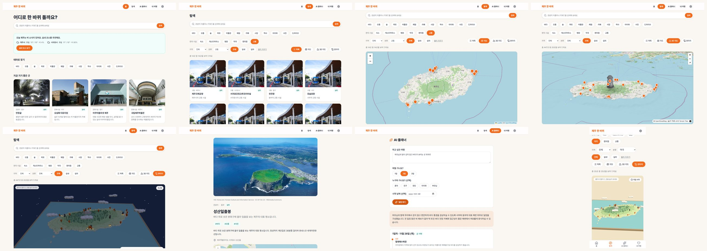
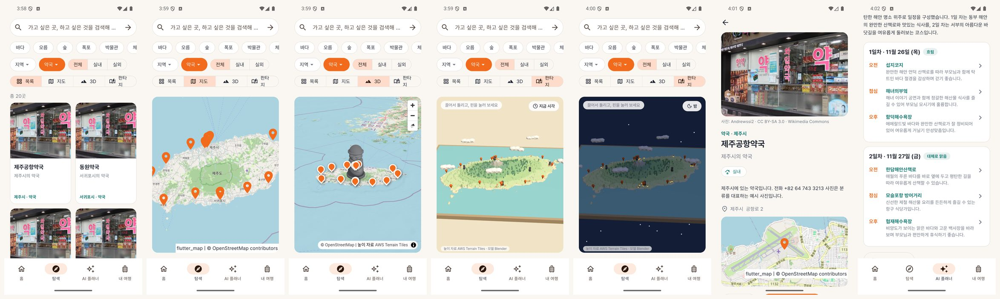

# 실측 테스트 — 배포 서버 · 배포 웹 · 앱 (2026-11-26)

3D 지도 · 판타지 지도 · 편의 시설을 넣은 뒤, **배포된 주소와 운영 DB** 로 서버 · 웹 · 앱을 다시 돌려 본 기록입니다. 자동 테스트(단위 테스트)와 달리, 실제 서버 · 실제 브라우저 · 실제 안드로이드 화면에서 확인한 것만 적었습니다.

| 대상 | 주소 · 환경 | 방법 | 결과 |
|---|---|---|---|
| 서버 | `https://jeju-hanbakwi-api.vercel.app` + 운영 DB(Supabase) | 실측 점검 도구 `python -m tools.check_live --api <서버 주소>` | ✅ 19개 통과, 0개 실패 |
| 웹 | `https://jeju-hanbakwi-web.vercel.app` | 실제 브라우저(크롬)를 자동으로 조작해 31가지 확인 | ✅ 30개 통과. 남은 하나는 일부러 연 없는 번호의 404 라 정상 |
| 앱 | 배포 서버 · 배포 웹을 가리키게 빌드한 디버그 apk, 안드로이드 에뮬레이터(Pixel 4) | 설치해 화면을 눌러 보며 확인 | ✅ 주요 화면 모두 동작. 문제 1건을 찾아 고침 |

## 서버 — 19개 통과

| 묶음 | 확인한 것 | 결과 |
|---|---|---|
| 누구나 볼 수 있는 주소 | `/health`, `/status`(DB ok · 관광지 447건 · 일정 방식 ai · 로그인 on · 사진 55장), `/meta`(테마 12개) | ✅ |
| DB 연동 | 전체 447건, 커서 페이징 23묶음(겹치거나 빠지지 않음), 테마 '바다', 실내, 검색 '성산' 14건, 검색어로 필터 조작 불가, 상세, 없는 번호 404, 사진과 출처 | ✅ |
| 외부 서비스 | 날씨(Open-Meteo) | ✅ |
| AI 일정 | 일정 짜기(방식 ai, 약 12초, 장소 4곳), 장소가 모두 DB 에 있는 곳 | ✅ |
| 로그인이 필요한 주소 | 토큰 없음 401, 틀린 토큰 401 | ✅ |
| 찜 · 일정 저장 | 로그인 토큰이 없어 점검하지 않음 | ⏳ |

## 웹 — 실제 브라우저로 31가지



위 줄 왼쪽부터 홈 · 편의 시설(교통) 목록 · 지도 · 3D 지도, 아래 줄 왼쪽부터 판타지 지도(밤) · 상세 · AI 플래너 · 휴대폰 폭(390px)입니다.

| 화면 | 확인한 것 | 결과 |
|---|---|---|
| 홈 | 추천 카드 8장, 제주시 · 서귀포 날씨, 편의 시설이 추천에 섞이지 않음 | ✅ 3 |
| 탐색 | 전체 447곳, 검색 '성산' 14곳, 테마 '바다' + 실외 151곳, "더 보기" 20 → 40곳, 결과 없음 안내 | ✅ 5 |
| 편의 시설 | 숙소 24 · 게스트하우스 20 · 병원 18 · 약국 20 · 편의점 24 · 교통 14 — 건수와 사진, 칩 여섯 개 | ✅ 7 |
| 지도 | 교통 14곳의 핀 14개 | ✅ 1 |
| 3D 지도 | 지도 캔버스, 핀 20개 | ✅ 2 |
| 판타지 지도 | 모델과 핀, 핀을 누르면 "오설록 티뮤지엄 · 자세히", 낮밤 단추(지금 시각 → 낮 → 밤), 밤 배경 | ✅ 4 |
| 상세 | 제목과 사진 출처, 지도, 없는 번호 안내 | ✅ 3 |
| AI 플래너 | 실제 AI 로 일정이 나옴, 일정에 편의 시설이 섞이지 않음 | ✅ 2 |
| 내 여행 | 로그인 전 안내 | ✅ 1 |
| 휴대폰 폭(390px) | 홈과 탐색(판타지)이 옆으로 넘치지 않음 | ✅ 2 |
| 브라우저 오류 | 404 한 건 — 일부러 연 `/spots/99999999` 의 응답이라 정상 | (정상) |

## 앱 — 안드로이드 에뮬레이터



왼쪽부터 약국 목록 · 지도 · 3D · 판타지 · 판타지(밤) · 상세 · AI 일정입니다.

| 화면 | 확인한 것 | 결과 |
|---|---|---|
| 홈 | 날씨 배너, 추천 카드 | ✅ |
| 탐색 — 목록 | 총 447곳. 분류 메뉴에 여행지 6 + 편의 시설 6 분류. 약국을 고르면 20곳 | ✅ |
| 탐색 — 지도 | 약국 핀 | ✅ |
| 탐색 — 3D | 지형, 돌하르방 모델, 핀(웹 화면을 웹뷰로) | ✅ |
| 탐색 — 판타지 | 제주 모델과 핀, 낮밤 단추로 밤 전환(별 · 마을 불빛) | ✅ |
| 상세 | 제주공항약국 — 사진과 출처, 전화, 지도 | ✅ |
| AI 플래너 | 실제 AI 로 2일 일정(섭지코지 · 함덕해수욕장 · 협재해수욕장 등), 날짜별 날씨 | ✅ |
| 내 여행 | "로그인 설정이 아직 없어요" — 이 PC 의 `app/env.json` 에 Supabase 값이 없어 로그인 뒤 흐름은 보지 못함 | ⏳ |

## 찾아서 고친 것

| 무엇 | 어떻게 |
|---|---|
| 앱 탐색의 보기 단추 "판타지" 글자가 휴대폰 폭에서 두 줄로 꺾임 | 단추 안쪽 여백과 아이콘을 줄이고 글자가 꺾이지 않게 함(`app/lib/screens/explore_screen.dart`). 다시 빌드해 한 줄로 나오는 것을 확인 |
| 배포 서버가 옛 코드로 돌고 있었음 | `main` 과 `step-7` 을 한꺼번에 푸시해 Vercel 이 운영 주소에 올리지 않았던 것. `main` 만 따로 푸시해 해결하고 `docs/steps.md` 에 적음 |

## 확인하지 못한 것

- 로그인 뒤 흐름(찜 · 일정 저장)의 실측 — 서버 점검은 토큰 없이, 앱은 Supabase 값 없이 돌렸습니다.
- 실제 안드로이드 폰, 앱 웹 빌드의 배포 주소.
- 판타지 지도가 새벽 · 저녁에 저절로 바뀌는 모습(단추로 바꾼 것만 확인).
- 35명이 동시에 쓸 때의 속도.

## 다시 돌리는 방법

```powershell
python -m tools.check_live --api https://<내 서버>.vercel.app
```

`api` 폴더에서 실행합니다. 웹과 앱은 자동화 도구 없이도 [CHECKLIST.md](CHECKLIST.md)의 표를 위에서부터 눌러 보며 확인할 수 있습니다. 앱을 배포 서버에 붙여 빌드할 때는 `app` 폴더에서 아래처럼 주소를 넣습니다.

```powershell
flutter build apk --debug --dart-define-from-file=env.json --dart-define=API_URL=https://<내 서버>.vercel.app --dart-define=WEB_URL=https://<내 웹>.vercel.app
```

## 기능 구현 영상

같은 날, 배포된 웹을 실제 브라우저로 조작하며 녹화하고 무료 음성 합성(edge-tts)으로 해설과 자막을 붙인 2분 29초 영상을 만들었습니다. 홈 → 탐색 → 편의 시설 → 지도 → 3D 지도 → 판타지 지도 → 낮과 밤 → 상세 → AI 플래너 → 일정 결과 순서입니다. 영상 파일은 크기 때문에 저장소에 넣지 않았고, 만드는 스크립트만 넣었습니다.

```powershell
pip install playwright edge-tts pillow
python tools/make_video.py https://<내 웹>.vercel.app
```

저장소 맨 위 폴더에서 실행합니다. ffmpeg 가 있어야 하고, 결과는 `tmp_video/jeju_intro.mp4` 에 생깁니다. 해설 문구와 장면 순서는 스크립트 위쪽의 `SCENES` 에서 고칩니다. 앱(에뮬레이터) 화면은 넣지 않았습니다.

