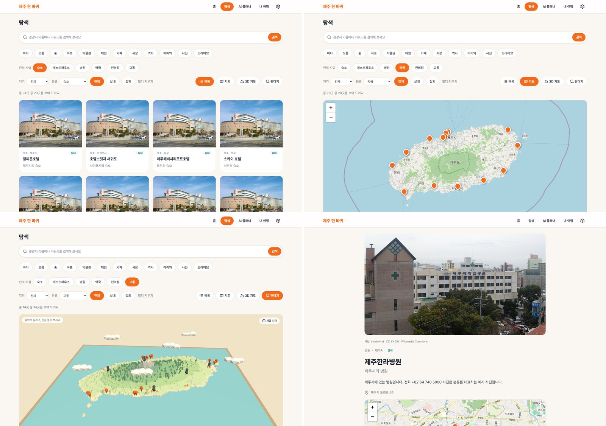

# 편의 시설 — 숙소 · 게스트하우스 · 병원 · 약국 · 편의점 · 교통

여행지는 아니지만 여행 중에 찾게 되는 곳 120곳을 위치와 함께 넣을 수 있습니다. 탐색 화면에서 분류를 고르면 목록 · 지도 · 3D 지도 · 판타지 지도에 그대로 나옵니다.



아래 화면은 로컬에서 실제로 실행해 캡처한 것입니다(2026-11-26, 서버 + 로컬 DB).

## 무엇이 들어 있나

| 분류 | 건수 | 예 |
|---|---|---|
| 숙소 | 24 | 호텔 · 리조트 |
| 게스트하우스 | 20 | 게스트하우스 · 호스텔 |
| 병원 | 18 | 제주한라병원, 서귀포의료원, 동네 의원 |
| 약국 | 20 | |
| 편의점 | 24 | |
| 교통 | 14 | 제주국제공항, 제주 · 서귀포 시외버스터미널, 여객터미널과 항구 |

네 지역(제주시 · 서귀포시 · 동부 · 서부)에서 번갈아 골라 한쪽에 몰리지 않게 했습니다. 파일은 `api/data/sample_places.json` 입니다.

## 넣는 방법

`api` 폴더에서 실행합니다. 여행지 샘플(`--sample`, 68건)과 따로 넣습니다.

```powershell
python -m tools.sync_spots --places --dry-run
```

```powershell
python -m tools.sync_spots --places
```

첫 줄은 무엇이 들어갈지만 보여 주고, 둘째 줄이 DB 에 넣습니다. 같은 곳을 다시 넣어도 한 줄로 유지됩니다.

## 지켜지는 규칙

- **분류를 골랐을 때만 나옵니다.** 분류를 고르지 않은 목록(홈의 추천, 탐색의 처음 화면, AI 일정의 후보)에는 편의 시설이 섞이지 않습니다. 약국이 여행 일정에 들어가면 안 되기 때문입니다. 규칙은 `api/repo.py` 의 `list_spots` 한 곳에 있습니다.
- **`/status` 의 `spots` 는 여행지 수 그대로**입니다(편의 시설을 넣어도 68).
- 선택지는 `GET /meta` 의 `place_categories` 로 내려갑니다. 여행지 분류(`categories`)는 그대로입니다.
- DB 의 표는 바꾸지 않았습니다. 여행지와 같은 `spots` 표에 `category` 만 다르게 들어갑니다(`source` 는 `osm`).

## 어디를 보면 되나

| 무엇 | 어디 |
|---|---|
| 편의 시설 분류 | `api/constants.py` 의 `PLACE_CATEGORIES` |
| 한 건을 DB 한 줄로, 좌표로 지역 정하기, 분류별 대표 사진 | `api/transform.py` 의 `to_place_row`, `area_by_position`, `PLACE_PHOTOS` |
| 공개 지도에서 받아 고르기 | `api/tools/make_sample_places.py` |
| DB 에 넣기 | `api/tools/sync_spots.py --places` |
| 웹: 편의 시설 칩, 분류 선택지 | `web/src/app/explore/page.tsx`, `web/src/lib/exploreFilters.ts` 의 `categoryOptions` |
| 앱: 분류 메뉴 | `app/lib/models/spot.dart` 의 `Meta.allCategories` |
| 테스트 | `api/tests/test_places.py` |

## 자료의 출처와 한계

- **위치와 이름**: [OpenStreetMap](https://www.openstreetmap.org/copyright)(© OpenStreetMap contributors, ODbL)에서 2026-11-26 에 받았습니다. 키가 필요 없습니다.
- **누구나 고치는 공개 지도**라 문을 닫았거나 이름이 바뀐 곳이 섞여 있을 수 있습니다. 실제 영업 여부는 확인하지 않았습니다. 수업용 샘플로만 쓰고, 실제 서비스에는 공공데이터(예: 건강보험심사평가원의 병원 · 약국 정보, TourAPI 의 숙박)를 쓰세요.
- **주소와 전화번호**는 원본에 있는 곳만 들어 있습니다(주소 약 절반, 전화 약 4분의 1). 주소가 없는 곳이 많아 지역은 좌표로 정했습니다.
- **사진은 분류마다 한 장**입니다. 곳마다 공개 사진을 구할 수 없어서, 분류를 대표하는 예시 사진 여섯 장을 함께 씁니다. 파일은 `api/static/photos/places/` 에 있고 우리 서버가 내줍니다(바깥 사이트가 막혀도 보임). 저작자와 라이선스는 [photo-credits.md](photo-credits.md)에 있습니다.

## 다시 만들기 · 내 주제로 바꾸기

```powershell
python -m tools.make_sample_places
```

공개 지도에서 다시 받아 `sample_places.json` 을 새로 만듭니다. 분류마다 몇 곳을 고를지와 이름에 들어가야 하는 낱말은 `make_sample_places.py` 의 `RULES` 표에서 바꿉니다. 새 분류(예: 주유소 · 은행)를 더하려면 `PLACE_CATEGORIES`, `PLACE_PHOTOS`, `RULES` 세 곳에 한 줄씩 더하고 대표 사진을 한 장 넣습니다.

## 확인한 것과 아직인 것

| 확인한 것 | 아직 확인하지 못한 것 |
|---|---|
| 서버 테스트 163건(편의 시설 9건 포함), 웹 테스트 116건, 앱 테스트 128건 | 앱 화면(분류 메뉴에 여섯 분류가 보이는지는 테스트로만 확인) |
| 로컬 DB: 120건 적재, 기본 목록 68 유지, 분류별 조회, 사진 주소 | 120곳의 실제 영업 여부 |
| 웹 화면: 편의 시설 칩, 숙소 목록, 약국 지도, 교통의 판타지 지도, 병원 상세의 사진 출처, 홈 추천에 섞이지 않음 | |
| 운영(2026-11-26): 운영 DB 에 120건 적재, 기본 목록 447 유지, 여섯 분류 조회, 배포된 웹에서 약국 목록 · 교통 지도와 사진 | |
