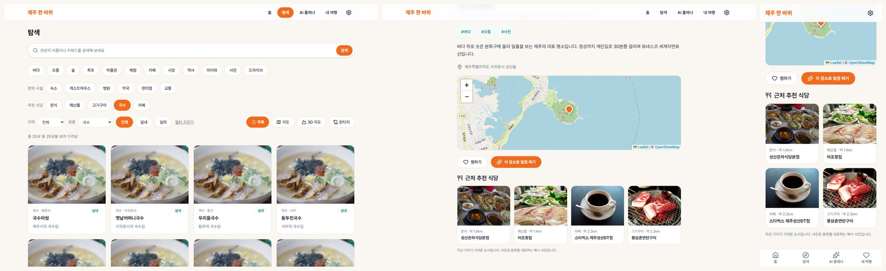
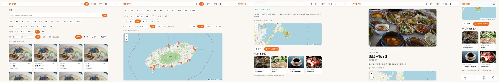
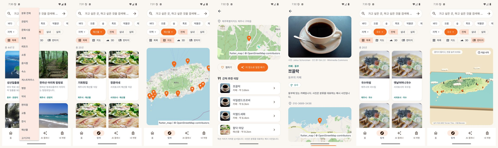
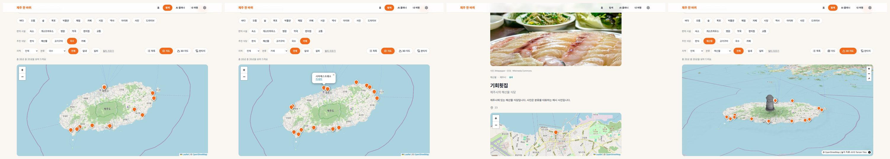
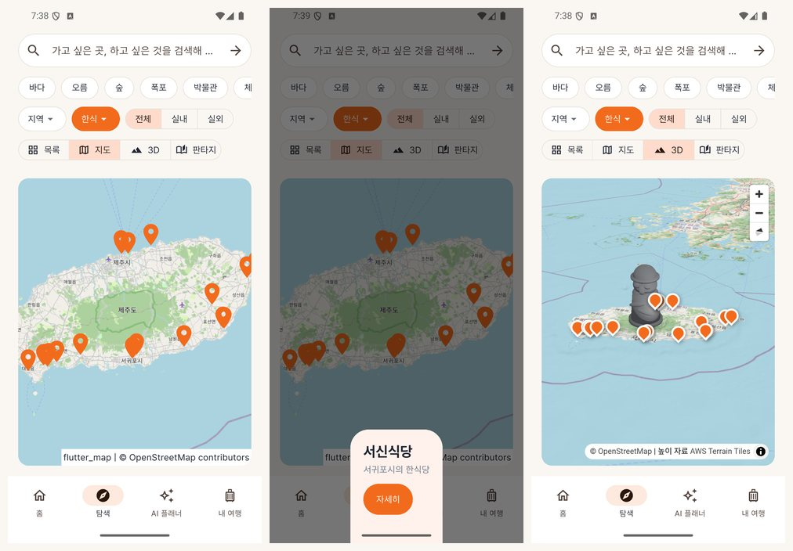
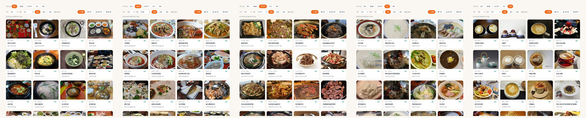
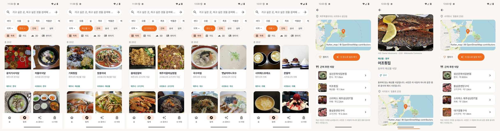

# 추천 식당 데이터 — 한식 · 해산물 · 고기구이 · 국수 · 카페 (2026-11-26)

여행지 가까이에서 밥 먹을 곳을 보여 주려고, 식당 100곳을 다섯 분류로 넣었습니다. 편의 시설([places.md](places.md))과 같은 방식으로 만들고, 상세 화면의 **"근처 추천 식당"** 기능을 더했습니다.



왼쪽부터 탐색에서 "국수"를 고른 목록, 성산일출봉 상세의 "근처 추천 식당", 같은 화면의 휴대폰 폭(390px)입니다.

## 무엇이 들어 있나

| 분류 | 건수 | 고르는 기준 |
|---|---|---|
| 한식 | 20 | 이름에 해장국 · 국밥 · 한정식, 지도에 한식으로 적힌 곳, 이름에 식당 · 정식 · 밥상 |
| 해산물 | 20 | 이름에 횟집 · 회센터 · 해녀 · 갈치 · 전복 · 물회, 지도에 해산물로 적힌 곳 |
| 고기구이 | 20 | 이름에 흑돼지 · 갈비 · 숯불 · 삼겹 · 연탄구이, 지도에 구이로 적힌 곳 |
| 국수 | 20 | 이름에 국수 · 칼국수 · 냉면 · 밀면 |
| 카페 | 20 | 지도에 카페로 적힌 곳 |

- 모두 100곳이고, 네 지역(제주시 · 서귀포시 · 동부 · 서부)에 25곳씩 고르게 나눴습니다.
- 파일은 `api/data/sample_restaurants.json` 입니다.

## 중복이 없게 한 방법

| 무엇과 | 어떻게 |
|---|---|
| 식당끼리 | 지도에서의 번호가 같으면 한 곳으로 보고, 띄어쓰기를 뺀 이름이 같아도 처음 것만 남깁니다 |
| 여행지 · 편의 시설과 | 이미 있는 여행지 68곳 · 편의 시설 120곳과 이름이나 번호가 같으면 뺍니다 |
| 다시 넣을 때 | DB 는 원본 번호(`source`, `source_id`)가 같으면 새 줄을 만들지 않고 고칩니다. 몇 번을 넣어도 100곳입니다 |

`api/tests/test_restaurants.py` 가 이 세 가지를 검사합니다(번호 · 이름이 겹치지 않음, 여행지 · 편의 시설과 겹치지 않음).

## 넣는 방법

`api` 폴더에서 실행합니다.

```powershell
python -m tools.sync_spots --restaurants --dry-run
```

건수를 미리 봅니다. 괜찮으면 `--dry-run` 을 빼고 다시 실행합니다.

```powershell
python -m tools.sync_spots --restaurants
```

## 지켜지는 규칙

- **분류를 골랐을 때만 목록에 나옵니다.** 분류를 고르지 않은 목록(홈 추천, 탐색의 처음 화면)에는 식당이 섞이지 않습니다. 전체 건수도 여행지 수 그대로입니다.
- **AI 일정의 후보에 들어가지 않습니다.** 일정에는 여행지만 나옵니다.
- **상세 화면의 "근처 추천 식당"** 에는 그 장소에서 직선 거리가 가까운 순으로 네 곳이 나옵니다. 식당 데이터를 넣지 않았으면 이 부분만 보이지 않습니다.
- 사진은 식당마다 다릅니다. 분류마다 공개 라이선스 음식 사진 20장을 골라 한 장씩 주었습니다(`api/static/photos/places/food/`, 목록은 `api/data/food_photos.json`). **그 식당을 찍은 사진이 아니라 같은 종류 음식의 예시 사진입니다.** 저작자와 라이선스는 [photo-credits.md](photo-credits.md)에 100장 모두 적었습니다.

## 어디를 보면 되나

| 무엇 | 파일 |
|---|---|
| 분류 이름 | `api/constants.py` 의 `FOOD_CATEGORIES` (여행지가 아닌 분류 모두는 `SIDE_CATEGORIES`) |
| 지도 자료 → 분류 정하기 · 중복 빼기 | `api/tools/make_sample_restaurants.py` 의 `food_category`, `drop_duplicates` |
| DB 한 줄로 바꾸기 · 사진 | `api/transform.py` 의 `to_place_row`(한 건에 `photo` 가 있으면 그것을, 없으면 분류 대표 사진 `FOOD_PHOTOS`), 식당마다의 사진 목록 `api/data/food_photos.json` |
| 가까운 순으로 고르기 | `api/services/nearby.py` 의 `distance_km`, `nearest` |
| 주소 | `GET /spots/{id}/restaurants` (`api/routers/spots.py`), `GET /meta` 의 `food_categories` |
| 웹 | 탐색의 "추천 식당" 칩(`web/src/app/explore/page.tsx`), 상세의 `web/src/components/NearbyRestaurants.tsx` |
| 앱 | 분류 메뉴(`Meta.allCategories`), 상세의 "근처 추천 식당"(`app/lib/screens/spot_detail_screen.dart`) |

## 자료의 출처와 한계

- 위치와 이름은 공개 지도 **OpenStreetMap**(© OpenStreetMap contributors, ODbL)에서 받았습니다. 키가 필요 없습니다.
- 누구나 고치는 지도라 **문을 닫았거나 이름이 바뀐 곳이 섞여 있을 수 있습니다.** 영업 여부 · 영업시간 · 가격은 확인하지 않았습니다.
- **"추천"은 맛을 평가했다는 뜻이 아닙니다.** 여행지 가까이에 있는 곳을 골라 보여 준다는 뜻입니다. 수업용 샘플로만 씁니다.
- 분류는 이름과 지도에 적힌 음식 종류로 정했습니다. "○○식당"처럼 이름만으로 한식에 넣은 곳은 실제와 다를 수 있습니다.
- 거리는 직선 거리입니다. 길을 따라 가는 거리 · 시간이 아닙니다.

## 다시 만들기 · 내 주제로 바꾸기

```powershell
python -m tools.make_sample_restaurants
```

공개 지도에서 다시 받아 `sample_restaurants.json` 을 새로 만듭니다. 지도 서버가 바쁘면 502 오류가 나기도 하니 잠시 뒤 다시 실행합니다. 분류를 바꾸려면 `FOOD_CATEGORIES`, `FOOD_PHOTOS`, `make_sample_restaurants.py` 의 `RULES` 세 곳을 함께 고칩니다.

## 확인한 것과 아직인 것

| 무엇 | 결과 |
|---|---|
| 자동 테스트 | ✅ 서버 175건(식당 12건 포함) · 웹 120건 · 앱 134건, 앱 분석 0건 |
| 로컬 DB 에 넣기 | ✅ 100건. 분류마다 20건, 기본 목록은 68건 그대로 |
| 근처 추천 식당 | ✅ 성산일출봉 → 성산은하식당본점(1.0km) · 어조횟집(1.1km) · 스타벅스 제주성산DT점(2.2km) · 뚱삼춘연탄구이(2.3km) |
| AI 일정 | ✅ 일정에 식당 분류가 섞이지 않음(로컬, 규칙 방식) |
| 웹 화면 | ✅ 탐색의 칩 다섯 개 · 목록 · 지도 핀 20개 · 상세의 근처 추천 식당 네 곳 · 식당 상세로 이동 · 휴대폰 폭에서 넘치지 않음 |
| 앱 화면 | ✅ 에뮬레이터에서 확인(아래 실측) |
| 운영 DB · 배포 주소 | ✅ 100건을 넣고 배포 서버 · 웹 · 앱으로 확인(아래 실측) |

## 실측 — 배포 서버 · 배포 웹 · 앱 (2026-11-26)

운영 DB(Supabase)에 100곳을 넣은 뒤, 배포된 주소로 다시 확인했습니다. 서버와 웹은 자동으로 29가지를 확인해 모두 통과했고, 앱은 배포 서버를 가리키게 빌드해 안드로이드 에뮬레이터(Pixel 4)에서 눌러 보았습니다.

| 대상 | 확인한 것 | 결과 |
|---|---|---|
| 운영 DB | `python -m tools.sync_spots --restaurants` | ✅ 100건(분류마다 20건) |
| 서버 | `/meta` 의 `food_categories`, 분류를 고르지 않은 목록은 447건 그대로, 분류마다 20건과 사진, 번호 · 이름이 겹치지 않음, 여행지 · 편의 시설 683곳과도 겹치지 않음, 근처 추천 식당(가까운 순), 없는 장소 404, AI 일정에 식당이 섞이지 않음(방식 ai) | ✅ 12 |
| 웹 | 홈 추천에 식당 없음, 탐색의 칩 다섯 개와 처음 목록 447곳, 칩마다 20곳과 사진, 지도 핀 20개, 판타지 지도, 상세의 근처 추천 식당 네 곳, 식당을 누르면 그 식당 상세, 식당 상세의 사진 출처 · 지도, AI 플래너에 식당 없음, 휴대폰 폭에서 넘치지 않음, 브라우저 오류 0건 | ✅ 17 |
| 앱 | 분류 메뉴에 한식 · 해산물 · 고기구이 · 국수 · 카페, 해산물 20곳 목록과 지도 핀, 만장굴 상세의 근처 추천 식당 네 곳(쪼끌락 3.6km …), 식당을 누르면 그 식당 상세(사진 출처 · 전화 · 지도), 국수 20곳, 판타지 지도의 식당 핀 | ✅ |
| 기존 실측 점검 | `python -m tools.check_live --api https://jeju-hanbakwi-api.vercel.app` | ✅ 19개 통과, 0개 실패 |





- 근처 추천 식당 예: 성산일출봉 → 성산은하식당본점(1.0km) · 어조횟집(1.1km) · 스타벅스 제주성산DT점(2.2km) · 뚱삼춘연탄구이(2.3km).
- ⏳ 확인하지 못한 것: 실제 안드로이드 폰, 로그인 뒤 식당을 찜하는 흐름, 앱 웹 빌드의 배포 주소.

## 실제 지도에 표시되는지 (2026-11-26)

배포 주소에서, 식당이 실제 지도 위의 제자리에 찍히는지 따로 확인했습니다.

| 무엇 | 방법 | 결과 |
|---|---|---|
| 좌표가 실제 그 자리인가 | 분류마다 한 곳의 좌표를 공개 지도의 주소 찾기(좌표 → 주소)에 넣어 봄 | ✅ 다섯 곳 모두 그 자리의 이름이 식당 이름과 같음 — 꽁지기사식당(일주동로) · 기회횟집(중앙로) · 옵데강갈비(탑동로13길) · 국수마씸(관덕로2길) · 시마에스프레소(서해안로) |
| 웹 지도(Leaflet · OpenStreetMap) | 분류마다 핀 수, 핀이 지도 안에 있는지, 핀이 퍼진 모양이 좌표가 퍼진 모양과 같은지 | ✅ 다섯 분류 모두 핀 20개, 화면과 좌표의 모양이 같음(예: 국수 1.90 / 1.90) |
| 웹 지도의 핀 누르기 | 핀을 누르면 뜨는 글 | ✅ "시마에스프레소 · 자세히" |
| 웹 식당 상세의 작은 지도 | 핀 하나 | ✅ 기회횟집 |
| 웹 3D 지도(MapLibre) | 해산물 · 국수의 핀 수 | ✅ 각 20개, 지형 위에 표시 |
| 앱 지도(flutter_map) | 한식을 골라 지도 보기, 핀 누르기 | ✅ 핀이 제주 전역에 찍히고, 누르면 "서신식당 · 서귀포시의 한식당 · 자세히" |
| 앱 3D 지도 | 한식을 골라 3D 보기 | ✅ 지형과 돌하르방 위에 핀 |





- 이 확인에서 찾아 고친 것: 식당 25곳의 주소가 번지뿐("23")이거나 비어 있었습니다. 길 이름이 없는 곳은 지역 이름(제주시 · 서귀포시 · 동부 · 서부)으로 바꾸고 로컬 · 운영 DB 에 다시 넣었습니다. 좌표와 100곳의 구성은 그대로입니다.
- 좌표 대조는 분류마다 한 곳씩 다섯 곳만 했습니다. 100곳 모두를 하나씩 대조하지는 않았습니다.

## 식당마다 다른 사진 (2026-11-26)

처음에는 분류마다 사진 한 장을 함께 써서, 같은 분류의 식당 20곳이 모두 같은 그림이었습니다. 식당마다 다른 사진으로 바꿨습니다.



- 위키미디어 공용에서 공개 라이선스(CC0 · 퍼블릭 도메인 · CC BY · CC BY-SA) 음식 사진을 분류마다 모아, 눈으로 보고 20장씩 골랐습니다. 상표나 가격표가 크게 보이는 것, 기내식처럼 식당 음식이 아닌 것, 서로 겹치는 것은 뺐습니다.
- `tools/make_sample_restaurants.py` 가 분류 안에서 차례로 한 장씩 붙입니다. 테스트가 100곳의 사진 주소가 모두 다르고 파일과 출처가 있는지 검사합니다.
- **그 식당의 실제 사진이 아닙니다.** 상세 화면의 소개 글과 "근처 추천 식당" 아래에 "같은 종류 음식의 예시 사진"이라고 적었습니다.

### 앱에서 확인 (2026-11-26)

지금 소스를 배포 서버 주소로 빌드해 안드로이드 에뮬레이터(Pixel 4)에 설치하고 눌러 보았습니다. 앱이 뜨는 동안 로컬 서버에는 요청이 한 건도 없었으므로, 화면의 사진은 배포 서버에서 받은 것입니다.



| 무엇 | 어떻게 | 결과 |
|---|---|---|
| 탐색 목록 | 한식 · 해산물 · 고기구이 · 국수 · 카페를 차례로 골라 끝까지 내림 | ✅ 분류마다 "총 20곳", 이름 20개가 모두 보임 |
| 사진이 서로 다른지 | 저장소의 원본 사진 100장을 앱 화면 35장과 그림 대조 | ✅ 100장 모두 화면에서 찾음(분류마다 20장) |
| 상세의 근처 추천 식당 | 성산일출봉 상세를 내려서 봄 | ✅ 네 곳(한식 · 해산물 · 카페 · 고기구이)의 사진이 서로 다름, 아래에 "같은 종류 음식의 예시 사진" 안내 |
| 식당 상세 | 근처 식당 "어조횟집"을 누름 | ✅ 큰 사진, "사진: … · CC0 · Wikimedia Commons" 출처, 소개 글의 예시 사진 안내, 그 식당 근처의 다른 식당 네 곳 |

- 사진을 바꾸기 전에 빌드한 앱에는 근처 추천 식당 아래 문구가 옛 문구("분류를 대표하는 예시 사진")로 남아 있었습니다. 문구는 앱 안에 들어 있어서, 다시 빌드해 설치해야 바뀝니다. 사진은 서버에서 받으므로 옛 앱에서도 바뀌어 보였습니다.
- ⏳ 확인하지 못한 것: 실제 안드로이드 폰, 지도 · 3D · 판타지 보기에서의 사진(이번에는 목록과 상세만 봄).
